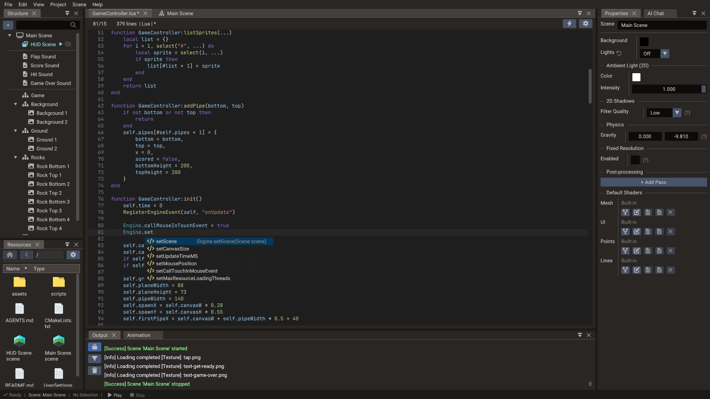
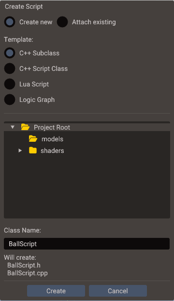
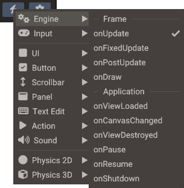
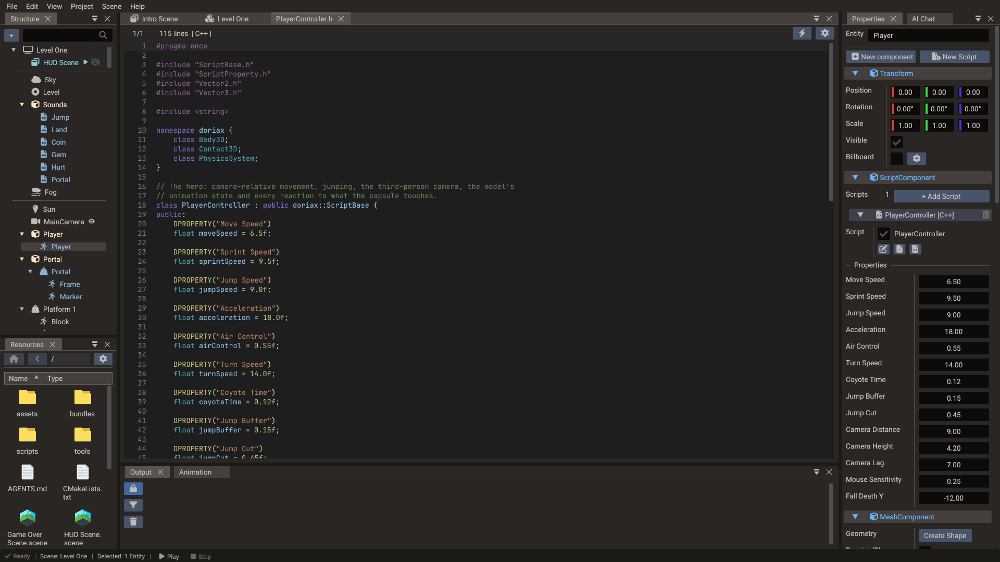

# Code Editor

The integrated code editor lets you write and edit Lua and C++ scripts without leaving
the Doriax editor. It provides syntax highlighting, API completion, script creation
dialogs, and a live output panel for compile and export messages.



!!! tip "Prefer your own IDE?"
    Scripts can open in VS Code, Visual Studio or CLion instead, with completion, hover
    documentation and debugging there. See [IDE Integration](ide-integration.md).

## Supported workflows

| Workflow | Notes |
| --- | --- |
| **Lua scripts** | Fast iteration — script-only changes take effect immediately in play mode without rebuilding |
| **C++ scripts** | Compiled at export/build time for native performance; require a rebuild to take effect |
| **GLSL shaders** | Edit [shader files](../manual/shader-files.md) (`.glsl`); saving recompiles the shaders that use them and refreshes the viewport. See [Custom Shaders](custom-shaders.md) |
| **Script templates** | Create new Lua or C++ script files from boilerplate using the **New Script** dialog |
| **Event menu** | Add an engine, input, component, physics, or monetization event handler to a script in one click. See [Add events](#add-events) |
| **API completion** | Engine API suggestions generated from Lua bindings; covers classes, methods, properties, and constants. Properties that return a [copy](../manual/math-and-utilities.md#changing-one-component-of-a-property) are marked `(copy)` |
| **Build output** | Compiler errors, warnings, and export messages stream into the Output panel |
| **Lua debugger** | Breakpoints, stepping, the call stack and variables for a project started with **Run Project**. See [Debugging Lua scripts](#debugging-lua-scripts) |

## Creating a new script

1. Select an entity and click **New Script** at the top of the **Properties** window.
2. Choose **Lua Script**, **C++ Subclass**, or **C++ Script Class**.
3. Enter the class/module name and confirm.

The editor generates the files from templates and attaches a `ScriptComponent` entry to
the entity; open them here with the header and source buttons on that entry. To link
*existing* files instead, choose **Attach existing** in the same dialog, or add an empty
entry with **Add Script** inside the ScriptComponent and pick the files in its edit
dialog — see
[Creating Scripts](../manual/creating-scripts.md#create-a-script-in-the-editor).



## Drag entities into your code

Drag an entity from the **Structure panel** onto a script open in the Code Editor to
create an entity reference property:

- **Lua file** — a typed entry is appended to the `properties` table.
- **C++ header** — a `DPROPERTY` line and pointer member are inserted (with the
  `#include` when the type is another script class). Dropping on a `.cpp` shows a
  reminder to use the header.

The property type comes from the dropped entity (its script class, or wrapper type such
as `Object`/`Mesh`/`Camera`), and the entity is assigned as the property value
automatically. See
[Script Properties](../manual/script-properties.md#insert-entity-references-by-drag-and-drop).

## Add events

The **lightning** button (*Add event*) at the top of a Lua or C++ script window, next to
the **gear**, opens the menu of events a script can subscribe to:

| Menu | Events |
| --- | --- |
| **Engine** | Frame updates (`onUpdate`, `onFixedUpdate`, `onPostUpdate`, `onDraw`), application events (`onPause`, `onResume`, `onShutdown`, ...) and `onSceneLoaded` |
| **Input** | Keyboard, mouse, touch, and gamepad events |
| **UI**, **Button**, **Scrollbar**, **Panel**, **Text Edit**, **Action**, **Sound** | Events of that component, which the script's entity needs to have |
| **Physics 2D**, **Physics 3D** | Contacts, sensors, body activation, and collision filters, for every body in the scene |
| **AdMob**, **In-App Purchase**, **Web Portal** | Results of the [monetization services](../manual/monetization.md): ads loaded, shown and rewarded, purchases, portal ads and cloud saves. They belong to the class, so any script can add them |



The **Touch** section of **Input** includes `onTouchCancel(pointer, x, y)` for
releasing an interrupted finger's action without a click. A full cancellation calls
the handler once per tracked finger. See
[Touch cancellation](../manual/events.md#touch-cancellation) for notification order
and how to handle fingers that remain down.

Each entry shows the handler parameters. Picking one writes the code the event needs and
puts the caret inside the new handler:

=== "C++"

    The `REGISTER_*` macro goes in the constructor and its `UNREGISTER_*` pair in the
    destructor. The handler is declared in the header and defined in the source file, and
    the event's header (such as `ButtonComponent.h` or `AdMob.h`) is included when
    missing. It works from either file of the script; the other one, with the same name
    next to it, is opened when the handler goes there. Monetization events register with
    `REGISTER_EVENT(AdMob::onAdLoaded, onAdLoaded)`.

    ```cpp
    Menu::Menu(Scene* scene, Entity entity): ScriptBase(scene, entity) {
        REGISTER_ENGINE_EVENT(onUpdate);
        REGISTER_BUTTON_EVENT(onPress, onPress);
    }

    Menu::~Menu() {
        UNREGISTER_BUTTON_EVENT(onPress, onPress);
    }

    void Menu::onPress() {

    }
    ```

=== "Lua"

    The registration goes in `init()`, which is created when missing, and the handler
    before `return Name`. Monetization events register with
    `RegisterEvent(self, AdMob.onAdLoaded, "onAdLoaded")`.

    ```lua
    function Menu:init()
        RegisterEngineEvent(self, "onUpdate")
        RegisterEvent(self, Button(self.scene, self.entity):getButtonComponent().onPress, "onPress")
    end

    function Menu:onPress()

    end
    ```

An event the script already registers shows a check mark, and picking it moves the caret
to its handler. Engine and input handlers are named like the event, as
`REGISTER_ENGINE_EVENT` and `RegisterEngineEvent` require. Other handlers are named after
the event too (`onPress`, `onBeginContact2D`), with the component added when that name is
taken: **Sound > onPause** becomes `onSoundPause`, since `onPause` belongs to the engine
event. Monetization events add their class instead: the second `onInitialized` a script
handles becomes `onAdMobInitialized`, `onInAppPurchaseInitialized` or
`onWebPortalInitialized`. Collision filters (`preSolve2D`, `shouldCollide2D`,
`shouldCollide3D`) start with `return true`, so every contact is kept until you add a
condition.

Each change is one undo step in the files open in the Code Editor. A closed header that
only needs the declaration is saved directly.

## Changed lines

When the project is kept in Git with
[Version Control Files](version-control.md#git-in-the-editor) on, the gutter marks every
line that differs from the staged version of the file, as VS Code does:

| Mark | Meaning |
| --- | --- |
| Green bar | Added lines |
| Striped blue bar | Changed lines |
| Red triangle | Lines were removed here |

The same colors mark the changes on the left of the scrollbar, to find them in a long
file. Rest the mouse on a mark to see the change: the removed lines in red, the lines that
replaced them in green, and the characters that changed highlighted. The arrow at the top
of the popup reverts the change to the staged lines, as one undo step.

The marks follow your typing and compare with what is staged, so staging a change clears
its marks. Untracked, ignored and conflicted files have none, and neither has a file
opened through a symbolic link.

## Debugging Lua scripts

**Project → Run Project** (**Ctrl+F5**) builds the project and runs it in a window of its
own, as a separate program, with the Lua debugger attached. The editor stays free while a
script is stopped: you read its variables here while the project waits.

Click a line number of a Lua script, or press **F9** on a line, to put a breakpoint there:
a red dot. When that line is about to run, the project stops, the editor shows the line in
yellow, and the **Debugger** panel opens beside Output:

| Control | Key | Does |
| --- | --- | --- |
| **Continue** | F5 | Runs until the next breakpoint |
| **Step Over** | F10 | Runs the line, without stopping inside the functions it calls |
| **Step Into** | F11 | Goes into the function the line calls |
| **Step Out** | Shift+F11 | Runs until the function returns |
| **Pause** | | Stops at the next line of Lua that runs, to find where a script is stuck |
| **Stop** | | Ends the project |

**Call Stack** lists the functions that led to the line; click one to see its line and its
variables. **Variables** has the locals and upvalues of that function: expand a table to
see its fields. A Lua error that no `pcall` catches also stops the project, on the line
that raised it, with the message in the panel and the variables still there.

Breakpoints follow the text as you edit, and can be added or removed while the project
runs. Things to know:

- Running the project builds its executable, so it needs the
  [C++ build tools](../manual/cpp-build-setup.md) even when all scripts are Lua. The first
  build takes the longest.
- Open scenes run as they are in the editor, saved or not. Scripts are saved first.
- It is the same build as the `doriax` preset of
  [IDE Integration](ide-integration.md#c-scripts): C++ scripts can be debugged there, in
  an IDE.
- **Play** in the Scene window runs the scene inside the editor, where breakpoints do not
  stop.
- Lua runs slower while the debugger watches each line.
- A breakpoint inside a coroutine stops there, but a step that leaves the coroutine
  continues to the next breakpoint.

## Script entry point

Scripts subscribe to the engine events they need (`onUpdate`, `onFixedUpdate`,
`onPause`, `onResume`, `onShutdown`, and the input events). Lua scripts register in
`init()`; C++ scripts register in the constructor and unregister in the destructor:

=== "Lua"

    ```lua
    local Player = {}

    function Player:init()
        RegisterEngineEvent(self, "onUpdate")
    end

    function Player:onUpdate()
        -- called every frame
    end

    return Player
    ```

=== "C++"

    ```cpp
    #include "ScriptBase.h"

    class Player : public doriax::ScriptBase {
    public:
        Player(doriax::Scene* scene, doriax::Entity entity);
        ~Player();

        void onUpdate();
    };
    ```

    ```cpp
    Player::Player(Scene* scene, Entity entity) : ScriptBase(scene, entity) {
        REGISTER_ENGINE_EVENT(onUpdate);
    }

    Player::~Player() {
        UNREGISTER_ENGINE_EVENT(onUpdate);
    }
    ```

The [event menu](#add-events) writes this code for any event. See
[Creating Scripts](../manual/creating-scripts.md) for the full lifecycle and event
system documentation.

## DPROPERTY and script properties

Properties declared with `DPROPERTY` (C++) or in the `properties` table (Lua) appear
as editable fields in the **Properties window** automatically.



```cpp
DPROPERTY("Speed")
float speed = 5.0f;

DPROPERTY("Jump Force")
float jumpForce = 12.0f;
```

The editor parser reads `DPROPERTY` from C++ headers and populates the Properties
window without requiring a build. See
[Script Properties](../manual/script-properties.md) for syntax and type mapping details.

## Project entry points

A project can have both Lua and C++ startup paths. Set which one is active in project
settings, or keep both and use `NO_CPP_INIT` / `NO_LUA_INIT` to disable one at
compile time.

=== "C++ startup"

    ```cpp
    #include "Doriax.h"
    using namespace doriax;

    Scene scene;

    DORIAX_INIT void init() {
        Engine::setScene(&scene);
    }
    ```

=== "Lua startup"

    ```lua
    scene = Scene()
    Engine.setScene(scene)
    ```

## Practical tips

- Keep startup code small — move gameplay behavior into scripts or systems.
- Use `DPROPERTY` for values that designers should tune; avoid hard-coding magic
  numbers inside script logic.
- Watch the Output panel after every C++ edit or export; it shows the first compiler
  error clearly.
- Lua scripts iterate faster during development — prototype in Lua, port to C++ for
  performance-critical paths.
- Use the built-in [Log](../reference/classes/log.md) API for runtime diagnostics
  rather than relying on `print`.
