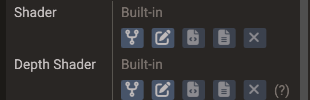
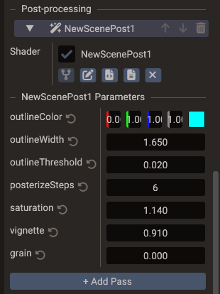

# Custom Shaders

Doriax ships built-in shaders for each renderable type (Mesh, UI, Points, Lines, Sky,
Water).
The editor lets you **fork** any of them into your project, edit the GLSL in the
[Code Editor](code-editor.md), and see the result in the viewport — without leaving the
editor. Forked shaders are compiled and shipped with your project just like the built-in
ones.

The same fork mechanism drives [post-process passes](#post-process-passes) — fullscreen
shaders a scene runs over the finished image.

## How customization works

A custom shader is a **fork** of a built-in shader. The editor copies the built-in
entry-point files (for example `mesh.vert` and `mesh.frag`) into a folder you pick in your
project; you edit the shading code while the rest of the rendering contract stays intact:

- The **variant system** is unchanged — the engine still injects the same feature
  defines (skinning, normal maps, shadows, IBL, fog, instancing, …) based on the mesh,
  so your edited shader keeps working across all of those cases.
- Skinned forks that `#include "includes/skinning.glsl"` bind bone matrices through a
  storage buffer, or through a bone texture when the editor compiles for OpenGL / OpenGL
  ES (`SKINNING_TEXTURE`). Re-fork that include if you copied an older `skinning.glsl`
  that still declared `mat4 bonesMatrix[MAX_BONES]` in a uniform block.
- The **shadow, depth, and G-buffer passes** keep using the built-in shaders, so shadow
  casting and screen-space effects continue to work. A Mesh can fork its **depth shader**
  as well — the one behind its shadow maps and the depth pre-pass — for a colour fork
  that moves vertices or discards fragments (see [The Depth Shader row](#the-depth-shader-row)).
  To only move vertices, a [vertex offset](#the-vertex-offset-and-coverage-rows) is simpler: one function
  that every pass applies.
- `#include` directives still resolve against the engine's shader library, so you only
  need the top-level `.vert`/`.frag` — not the whole include tree. If you want to edit the
  includes as well, the fork dialog can copy them for you (see [Includes](#includes)).

This means you customize the *surface/shading logic* while the engine continues to drive
lighting, passes, and built-in inputs. Values of your own — a wave speed, a dissolve
amount, the current time — reach the fork through its [shader parameters](#shader-parameters).

## The Shader row

Open the **Properties** window for a Mesh, UI, Points, Lines, Sky, or Water entity. Each
of these components has a **Shader** row:

| Control | Action |
| --- | --- |
| **Built-in** label | Shown when the component uses the default engine shader. |
| **Fork** | Opens the [Fork Shader dialog](#the-fork-shader-dialog) to choose where the fork is created and what it is called. On confirm it writes the files, assigns them to the component, and opens them in the Code Editor. |
| **Edit shader files** | Picks the `.vert` and `.frag` independently, so entry points that do not share a base name can be assigned. Changes apply as soon as both slots are set (or both cleared). |
| **Open vertex** / **Open fragment** | Re-opens the assigned file in the Code Editor. |
| **Reset to Built-in** | Clears the custom shader and returns to the engine default. |
| Drag-and-drop | Drop an existing `.vert`/`.frag` from the [Resources Browser](resources.md) onto the row to assign it. |



**Fork** is available only while the row shows **Built-in** — reset the shader first to
fork it again, so an existing fork is never orphaned by accident.

The Shader row is shown for a single selected entity (the path is per-entity). Assigning,
editing, or resetting a custom shader is undoable.

## The Depth Shader row

A Mesh component has a second row, **Depth Shader**, with the same controls. It forks
`depth.vert` and `depth.frag` — the shader the engine draws the mesh with into **shadow
maps**, into the optional scene [depth prepass](../manual/rendering-pipeline.md#depth-prepass),
and into the **depth pre-pass** that feeds SSAO and post-process depth while SSR is off
(with SSR on, those read the G-buffer, which keeps the built-in shader).

The colour fork never reaches those passes, so a mesh whose fork displaces vertices or
discards fragments keeps casting the shadow of its undisplaced, undiscarded geometry —
and self-shadows against it once the displacement grows. Fork the depth shader too, apply
the same displacement or `discard` there, and the shadow follows. The variant defines
(skinning, morph targets, terrain, instancing, alpha mask) are the ones `depth.vert` and
`depth.frag` already handle, so the fork keeps working across those cases.

A depth fork reads the same [shader parameters](#shader-parameters) as the colour fork,
so one value drives both: declare the same `#pragma param` names in it. It is compiled as soon as
it is set — even in a scene with no shadow-casting light — so build errors show up right
away; a fork that
fails to build is reported as **Depth shader failed to build** under the row while the
built-in depth shader keeps drawing.

The depth shader is per mesh — there is no scene default — and its fork name is pre-filled
with a `_depth` suffix. Like the colour fork it is undoable, saved with the scene, exported
with the project, and scriptable through `customDepthShader` (see
[Setting values from scripts](#setting-values-from-scripts)).

!!! note "Resolution in a depth fork"
    `Engine.resolution` is the size of the target being written: the shadow slot of a
    cascade or cube face, or the depth pre-pass target.

### Depth forks and the depth prepass

With the scene [depth prepass](../manual/rendering-pipeline.md#depth-prepass) on, the
depth fork also writes the depth the colour pass tests against, so both must land on the
same pixel. `u_vs_depthParams` carries `mvpMatrix` — the light (or camera) view-projection
already multiplied by the model matrix — and `depth.vert` sets `gl_Position` from it under
`invariant`, matching `mesh.vert` bit for bit. Keep that in a fork: multiplying
`lightVPMatrix * modelMatrix` yourself still compiles (older forks keep working) but can
round differently and z-fight in the prepass.

A mesh whose **colour** shader is forked — or covered by a scene default mesh shader —
without a depth fork is left out of the prepass and drawn once in the colour pass, since
the built-in depth shader cannot know where the fork moves its vertices. Add a depth fork
with the same displacement to bring it back in.

## The Vertex Offset and Coverage rows

A Mesh component also has a **Vertex Offset** row and a **Coverage** row, for meshes that
only need their vertices moved or part of their surface removed, without forking any
shader. Each takes one `.glsl` file with a single function:

```glsl
vec3 getVertexOffset(vec3 localPosition, vec3 worldPosition);
float getCoverage(CoverageContext context);
```

The engine runs them in the color, depth and G-buffer passes, so shadows, SSAO and
screen-space reflections follow without a depth fork, and the mesh keeps the built-in
shading. Their values are declared with `#pragma` lines, such as
`#pragma param float waveHeight = 0.2`, and edited in the effect's own **Parameters**
section under the table. See
[Shader Effects](../manual/shader-effects.md) for the functions, the parameters and the
engine's effects.

| Control | Action |
| --- | --- |
| **None** label | Shown while the mesh has no effect of that kind. |
| **New** | Writes a starting file to `shaders/<entity>_offset.glsl` or `shaders/<entity>_coverage.glsl`, assigns it, and opens it in the Code Editor. |
| **Engine effects** | Assigns one of the engine's own, such as `offsets/wind.glsl` or `coverage/see_through.glsl`, shown as *built-in*. |
| **Pick** | Assigns an existing `.glsl` from the project. |
| **Copy** | Copies the assigned built-in effect into the project, assigns the copy and opens it, to change it. |
| **Open** | Re-opens the assigned file. |
| **Remove** | Clears the effect. |
| Drag-and-drop | Drop a `.glsl` from the [Resources Browser](resources.md) onto the row. |

**Max Offset**, shown under a vertex offset, is the longest offset in world units: longer
ones are clamped, and culling widens the mesh bounds by it. **Cut Shadows**, shown under a
coverage function, makes the shadow maps follow the coverage too.

An effect file finds its [includes](#includes) like a fork, starting in its own folder.
Those files stay its own: a fork on the same mesh with a file of the same name does not
replace them. Each combination of fork and effect files builds its own shaders, compiled
and exported with the project like a fork. Terrain ignores both rows. Scripts set them
through `vertexOffsetShader`, `vertexOffsetMax`, `coverageShader` and `coverageShadows`.

## Water shaders

A [Water](../reference/classes/water.md) component has two rows. **Shader** forks
`water.vert` and `water.frag`, the surface itself. **Underwater Shader** forks
`fullscreen.vert` and `underwater.frag`, the fullscreen fade drawn over the scene while
the main camera is below the surface (it needs **Underwater** on). Its fork name is
pre-filled with an `_underwater` suffix, and a fork that fails to build is reported as
**Underwater shader failed to build** under the row while the built-in fade keeps
drawing.

Both forks read the water's [shader parameters](#shader-parameters) by name, so one
value can drive both. The surface shader can also be a
[scene default](#scene-default-shaders); the underwater shader is per water only.

The water fork keeps the engine's variant defines: `HAS_FOG`, `USE_SCENE_DEPTH` (Depth
Effects), `USE_PLANAR_REFLECTION`, `USE_SHADOWS`, and `USE_REFRACTION` — see
[Shader Variants — water](../manual/shader-variants.md#water).

!!! warning "Keep the engine blocks and the wave math"
    The engine fills `u_vs_waterParams`, `u_fs_waterParams`, and `u_fs_underwaterParams`
    by layout, not by name, so keep them as the fork copied them. New engine versions only
    append members at the end of `u_fs_waterParams`: a fork made on an older version keeps
    working without the newer effects, and logs a warning to fork it again.

    [Water.getHeight](../reference/classes/water.md#getheight-getnormal), body
    [buoyancy](../manual/physics.md#buoyancy), and the sorting of transparent objects
    around the water use the built-in wave sum. If a fork displaces the surface
    differently in `water.vert`, they no longer match the waves it draws.

## The Fork Shader dialog

Forking asks where the new shader goes before writing anything:

| Field | Meaning |
| --- | --- |
| **Destination folder** | A tree of the folders in your project. Defaults to `shaders` when it exists, otherwise the project root. |
| **Shader Name** | The file name stem, without an extension. Letters, digits, and underscores only; other characters become `_` as you type. |
| **Also fork shader includes** | Copies the engine `.glsl` files this shader actually uses so you can edit them too. See [Includes](#includes). |
| **Will create** | The exact files that will be written, project-relative. |

The name is pre-filled from the entity (or the scene and shader type, for a scene default)
and gets a numeric suffix if that name is already taken. **Create** stays disabled while a
target already exists — forks never overwrite files, because undoing one deletes what it
wrote.

The layout depends on whether you fork the includes:

| Option | Files created |
| --- | --- |
| Off | `<folder>/<name>.vert` and `<folder>/<name>.frag` |
| On | `<folder>/<name>/` containing `<name>.vert`, `<name>.frag`, and an `includes/` copy |

Forking includes gives the shader a folder of its own so your edited copies apply to that
shader alone. Creating the fork is a single undoable step — undo removes the files it
wrote and restores the previous shader.

## Scene default shaders

Besides per-component shaders, each scene can set a **default custom shader per type**.
Select the scene (no entity) in the **Structure panel** and look for the **Default
Shaders** section at the bottom of the scene settings in the Properties window. It shows
one row per applicable type — 3D scenes list Mesh, Sky, Water, UI, Points, and Lines; 2D
scenes omit Sky and Water; UI scenes list only UI.

Each row offers the same controls as the component Shader row (fork, edit files, open
`.vert`/`.frag`, reset, drag-and-drop), and every change is undoable.

The shader used by a component is resolved with this priority:

1. **Component shader** — a custom shader assigned on the component always wins.
2. **Scene default shader** — used by every component of that type with no shader of its
   own. Its Shader row shows the default's name followed by *(scene default)*.
3. **Engine built-in** — used when neither is set.

A component with no custom shader *inherits* the scene default; resetting a component's
shader returns it to the scene default (or the built-in if the scene has none). To keep a
single component on stock shading while a scene default is active, fork the built-in
shader for that component and leave it unedited.

A default that declares [shader parameters](#shader-parameters) lists them under its row,
in a section named after the fork (for example **toon Parameters**). Values set there
belong to the scene, and every component that inherits the shader reads them. A component
can still set its own value for a parameter, and that value wins (see
[Editing values](#editing-values)).

Scene default shaders and their values are saved with the scene, applied in play
mode, and exported like any other custom shader — components that inherit them compile and
ship the right shader variants automatically. They are also scriptable via the `Scene`
properties `defaultMeshShader`, `defaultUIShader`, `defaultSkyShader`, `defaultPointsShader`,
`defaultLinesShader`, and `defaultWaterShader` (see the
[Scene reference](../reference/classes/scene.md)), and the values through
[`setDefaultShaderUniform`](../reference/classes/scene.md#setdefaultshaderuniform), which
takes the shader type (`ShaderType.MESH`, `ShaderType.UI`, and so on).

## Shader parameters

A fork declares its own values with `#pragma` lines, and the engine fills them from fields in the
Properties window, from scripts, and from values the scene and its cameras share. This is
how a water, wave, fire, or dissolve effect gets its parameters.

Write one `#pragma param` line per value, in the vertex file, the fragment file, or an include,
and read it as `params.name`. Every built-in shader calls `loadShaderParameters()` at the
top of `main()`, which fills `params`, so a fork can read them anywhere after that:

```glsl
// wave.vert
#pragma param float amplitude = 0.2 [0, 1] "Height of the waves"
#pragma param float speed = 3 [0, 10]

// ... in main():
pos.y += sin(Engine.time * params.speed + pos.x * 4.0) * params.amplitude;
```

Keep that call in a fork: without it the values read zero, and the build warns about it.

!!! warning "Vertex displacement is colour-pass only"
    A fork only replaces the colour pass, so a vertex moved like this swims while its
    shadow stays where the mesh data is. Fork the [depth shader](#the-depth-shader-row)
    as well and displace there too, and the shadow (and SSAO, while SSR is off) follows.
    Screen-space reflections read the built-in G-buffer and keep the undisplaced surface.
    A [vertex offset](#the-vertex-offset-and-coverage-rows) moves every pass at once.

```glsl
// wave.frag
#pragma param vec4 tint = 0.2, 0.5, 1, 1 color

// ... at the end of main():
g_finalColor.rgb = mix(g_finalColor.rgb, params.tint.rgb, 0.5 + 0.5 * sin(Engine.time));
```

A name declared in both files is one value. The types are `float`, `vec2`, `vec3`, `vec4`,
`int`, and `ivec2` to `ivec4`, and a declaration can give a default, a range, a color picker,
and a tooltip. `#pragma scene` and `#pragma view` lines read values that the whole scene or one camera
shares, and `Engine.time` and `Engine.resolution` need no declaration. The syntax and where
each value comes from are in
[Shader Effects — Declaring parameters](../manual/shader-effects.md#declaring-parameters).

Every shader type takes them: Mesh, depth, UI, Points, Lines, Sky, Water, underwater, and
post-process forks. The shader builder packs the values of each stage into one uniform
block, so a fork declares no uniform block of its own: the engine never fills a block it
does not know. Changing a value never rebuilds the shader.

!!! warning "Forks from v0.8.4 and earlier"
    Older forks declared `u_vs_customParams`, `u_fs_customParams`, or `u_fs_postParams`
    blocks. The engine no longer fills them, and a fork that still declares one fails to
    build with an error naming the block.

    When a project with such files opens, the editor lists them and asks whether to
    rewrite them; answering No leaves them alone, and it asks again the next time. AI
    agents have `port_shader_fork` for one fork. The command line never rewrites them. The
    port changes each file in place: every block member becomes a `#pragma param` line
    read as `params.name`, with the comment after the member as its tooltip, `time`
    becomes `Engine.time` (it now follows the scene's clock), `resolution` becomes
    `Engine.resolution`, and the parameter include and the `loadShaderParameters()` call
    are added. The values saved by name on the component or the pass are kept. A file
    whose block has a member that is not a `float`, a `vec2` to `vec4`, an `int` or an
    `ivec2` to `ivec4` is left as it was, with the reason in the Output window.

    The port keeps the rest of the fork as it was, so a ported Mesh fork still lacks the
    hooks of [vertex offsets and coverage](#the-vertex-offset-and-coverage-rows). To get
    them, fork the current built-in again and copy your changes over. The port will be
    removed in a later version, so port old forks while it is there.

### Editing values

Each shader file of the component gets a **Parameters** section below the Shaders table,
named after the file (for example **wave Parameters**), with one field per `#pragma param`. Saving
the file updates the fields. Values are stored **on the component**, by name:

- A Mesh keeps one set of values for all of its submeshes, and its depth fork and effect
  files read the same values.
- A component that inherits a [scene default shader](#scene-default-shaders) shows the
  scene's value for any parameter it has not set. Editing the field gives the component its
  own value, which wins, so two meshes on the same default shader can still be tinted
  differently. A field with its own value has a reset arrow that goes back to the scene's.
- A parameter nobody set reads its declared default. Renaming or deleting a parameter
  leaves its old value unused.

The fields follow the declaration: a range limits the drag, `color` shows a color picker,
`int` types take whole numbers, and the description is the tooltip. Every edit is undoable,
and the values are saved with the scene and exported with it. The section also lists the
scene and view parameters the file reads, which are edited on the scene and on each camera.

!!! note "glTF models"
    A multi-node glTF `Model` renders through its part entities (one Mesh component
    each); the root's own Mesh is empty unless the model is merged or single-node. Fork
    and edit the shader, and set the values, on the parts — like colour and material —
    not on the Model root.

`Engine.resolution` is what screen-space effects need (scanlines, pixel snapping,
dithering against `gl_FragCoord`), and it follows the target: the same fork drawn by a
render-to-texture camera sees that camera's size. See
[Engine values](../manual/shader-effects.md#engine-values) for both engine values.

### Setting values from scripts

The same values are scriptable, so a parameter can follow gameplay or animate every frame.
`Mesh` (and everything derived from it — `Shape`, `Model`, `Sprite`, `Terrain`,
`Tilemap`), `Image`, `Text`, `Polygon`, `Points`, `Lines`, `SkyBox`, and `Water` all
expose:

| Method | Meaning |
| --- | --- |
| `setShaderUniform(name, value)` | Sets the value of a parameter. `value` is a `float`, `Vector2`, `Vector3`, or `Vector4`; the components a narrower value leaves out read zero. |
| `getShaderUniform(name)` | The component's own value as a `Vector4`, zero when unset. Declared defaults and values inherited from a [scene default](#scene-default-shaders) are not there. |
| `removeShaderUniform(name)` | Drops the value, so the parameter reads the inherited or declared default again. |
| `customShader` | The fork base path, so a script can assign or reset the fork too. |
| `customDepthShader` | A Mesh's [depth fork](#the-depth-shader-row) base path; it reads the same values. |
| `vertexOffsetShader` | A Mesh's [vertex offset](#the-vertex-offset-and-coverage-rows) file; it reads the same values. |
| `vertexOffsetMax` | The longest offset in world units, which also widens the culling bounds; 0 = no limit. |
| `customUnderwaterShader` | A Water's [underwater fork](#water-shaders) base path; it reads the same values. |

Setting a value only rewrites the uploaded block, with no shader reload, so calling it
every frame is fine:

=== "C++"

    ```cpp
    Shape water(&scene);
    water.createPlane(20, 20);
    water.setCustomShader("shaders/wave");
    water.setShaderUniform("amplitude", 0.3f);
    water.setShaderUniform("tint", Vector4(0.2f, 0.5f, 1.0f, 0.5f));
    ```

=== "Lua"

    ```lua
    function WaveScript:init()
        self.water = Shape(self.scene)
        self.water:createPlane(20, 20)
        self.water.customShader = "shaders/wave"
        self.water:setShaderUniform("amplitude", 0.3)
        self.water:setShaderUniform("tint", Vector4(0.2, 0.5, 1.0, 0.5))
        RegisterEngineEvent(self, "onUpdate")
    end

    function WaveScript:onUpdate()
        -- Engine.time needs no call: the engine writes it. Gameplay-driven values
        -- go through the same method every frame.
        self.water:setShaderUniform("amplitude", 0.3 * self.stormLevel)
    end
    ```

For a glTF model, call these on the part entities (`Mesh(scene, scene:findEntity("Body"))`), as the
note above explains. See the [Mesh reference](../reference/classes/mesh.md#setshaderuniform)
for the full signatures.

!!! note "The G-buffer pass"
    A Mesh's values reach its colour fork, its [depth fork](#the-depth-shader-row), and its
    effect files. The SSR G-buffer pass keeps the built-in shader and runs only the effect
    files, so a displacement written in a fork never moves the object's screen-space
    reflection, while a [vertex offset](#the-vertex-offset-and-coverage-rows) does.

## Post-process passes

A scene can run an ordered chain of **fullscreen passes** over its finished image:
sharpen, tint, vignette, colour grading, and so on. Each pass is a forked shader, and
unlike the component shaders above the chain belongs to the scene, not to any entity.


Select the scene (no entity) in the **Structure panel** and open the **Post-processing**
section of the scene settings in the Properties window.

| Control | Action |
| --- | --- |
| **Add Pass** | Appends a pass. A new pass starts on the built-in passthrough, which copies the image unchanged. |
| Pass header | Names the pass after its shader, followed by its place in the chain when the panel is wide enough (**NewScenePost1 [Pass 1]**). Click it to fold the pass. It is dimmed while the pass is disabled. |
| **↑** / **↓** | On the header. Moves the pass in the chain. Passes run top to bottom. |
| **🗑** | On the header. Removes the pass. Right-clicking the header offers the same actions. |
| Checkbox | Before the shader name in the **Shader** row. Enables or disables the pass without removing it. |
| **Shader** row | The same controls as any other shader row — fork, pick files, open, reset, drag-and-drop. |

Every change is undoable, and the chain is saved with the scene.

An agent connected through the [MCP server](mcp-server.md), or the AI Chat, edits the same
chain: `list_post_process_passes` reads it, `set_post_process_pass` adds, removes, moves,
enables, or repoints a pass, and `fork_shader` with `shader_type` set to `postprocess` adds
a pass with a new fork of the passthrough.



The chain runs on the scene's **active camera**, after the opaque, transparent, UI, and
SSR passes, and before the fixed-resolution upscale. Secondary cameras — minimaps,
mirrors, portals — do not run it; if the active camera itself renders to a texture, the
chain writes into that texture. A scene drawn as a layer skips its chain, because a
fullscreen pass would overwrite the scene below it.

### Writing a pass

Forking a post-process pass copies `fullscreen.vert` and `postprocess.frag` into your
project. The vertex shader draws a fullscreen triangle and normally needs no edits — all
the work happens in the fragment shader.

A pass may declare any subset of the inputs below; only the ones it actually uses are
bound:

| Sampler | Contents |
| --- | --- |
| `u_sceneColorTexture` | The previous pass's output, or the scene colour for the first pass. |
| `u_depthTexture` | Camera-space packed depth. The engine runs a depth pre-pass for the chain when SSR and SSAO are both off, so this is always available. |
| `u_gbufferTexture` | View-space normal, roughness, and metallic. Only produced while **SSR** is enabled; reads black otherwise. |
| `u_ssaoTexture` | Blurred ambient occlusion. Reads white while SSAO is off. |

!!! warning "Depth orientation"
    Depth and the G-buffer keep the logical orientation of the depth pre-pass, so flip
    `v_texcoord.y` when sampling them on the OpenGL backends. The built-in `ssr.frag` shows
    the pattern.

### Pass parameters

A pass declares its values like any fork, with `#pragma param` lines, and each one becomes a
field of the pass in a section named after the fork:

```glsl
#pragma param float amount = 0.5 [0, 1]
#pragma param float threshold = 0.8 [0, 1]
#pragma param vec4 tintColor = 1, 0.9, 0.8, 1 color

// ... in main(), one texel of the pass target:
vec2 texel = Engine.resolution.zw;
```

The values are stored by name on the pass. `Engine.resolution` holds the size of the pass
target and its inverse: use it for anything that depends on target size, since a texel
offset written as a literal breaks the moment the window resizes. `#pragma scene` and `#pragma view`
values work in a pass too, so it can follow the same `Weather.wetness` as the scene's
materials, and the pass's fullscreen vertex shader can declare parameters as well.

The values are scriptable as well. `scene:setPostProcessUniform(index, name, value)`
rewrites one value of the pass at `index` (top of the list is 0, also from Lua) without
rebuilding the chain, so it can run every frame; `scene:getPostProcessUniform(index, name)`
reads it back, `scene:removePostProcessUniform(index, name)` drops it, and
`scene:setPostProcessPassEnabled(index, enabled)` toggles a pass. The
whole chain is available as `scene.postProcessPasses` — a list of `PostProcessPass` values
with `shader`, `enabled`, and `setUniform`/`getUniform` — for scripts that build it
themselves (in Lua a 1-based sequence, so `scene.postProcessPasses[1]` is pass index 0):

=== "C++"

    ```cpp
    scene.setPostProcessUniform(0, "amount", 0.8f);
    ```

=== "Lua"

    ```lua
    scene:setPostProcessUniform(0, "amount", 0.8)
    ```

See the [Scene reference](../reference/classes/scene.md#setpostprocessuniform).

### Export

Every pass ships its forked shader, including disabled ones — the generated scene carries
the whole chain, and the enable flag is a runtime value. A pass whose shader fails to
compile falls back to the passthrough, so the scene keeps rendering; the list marks it
**Shader failed to build** and the compiler output goes to the Output panel.

## Editing and live updates

Forked shaders open in the [Code Editor](code-editor.md) with GLSL syntax highlighting
(`.vert`, `.frag`, and `.glsl` files). When you **save** a shader source file, the editor
recompiles the affected forked shaders and refreshes the viewport — no rebuild or replay
needed.


Only shaders that actually reach the edited file through `#include` are rebuilt: the
editor tracks each fork's real dependency graph rather than assuming everything in a
folder is related. Editing a shader in an external editor works too — the change is picked
up when the Code Editor reloads the file.

!!! tip "Iterate fast"
    Keep the file open, tweak, **Ctrl+S**, and watch the viewport update.

### Vertex attribute limit

A vertex stage can declare at most **16 inputs**, and each one has to sit at a
`layout(location = N)` below 16 — the location indexes the engine's attribute semantic
table, which is what the HLSL and Metal backends bind against. A shader that goes past
either limit fails to compile with the offending input named in the Output panel, and the
component keeps the shader it had. Reuse a free location or pack values into a wider
vector instead of adding another input.

Fragment inputs and outputs are not bound by that table, so varyings between stages are
free of the limit.

## Includes

Shaders include by a fixed key — `#include "includes/pbr.glsl"` — and a fork resolves each
key in this order, taking the first that exists:

| Order | Location | Scope |
| --- | --- | --- |
| 1 | The fork's **own folder** | That fork only |
| 2 | The **project root** | Every fork in the project |
| 3 | The **engine shader library** | The default for everything |

A fork's folder mirrors the engine shader library, so a key keeps its shape:
`includes/pbr.glsl` is looked up at `<fork folder>/includes/pbr.glsl`.

- **Use an engine include** — `#include "includes/pbr.glsl"` resolves to the engine's copy
  automatically; you do not need to copy anything.
- **Override an include for one shader** — tick **Also fork shader includes** when you
  fork. The copies land in the fork's own folder and win for that shader alone.
- **Override an include for the whole project** — put the file at the same key under the
  project root, for example `<project>/includes/pbr.glsl`.
- **Add your own include** — drop a `.glsl` next to the fork and include it by its path
  relative to the fork folder (`#include "lib/noise.glsl"`), or put it anywhere in the
  project and include it relative to the project root
  (`#include "shaders/lib/noise.glsl"`).

Overrides never change the engine's built-in rendering — a built-in shader always uses the
engine library. A fork stored loose in a folder shares whatever `includes/` that folder
holds, which is why forking includes moves the shader into a folder of its own.

!!! note "Moving a fork"
    Nothing about the fork is recorded anywhere but its file paths, so you can move,
    rename, or copy it freely — including by hand — and its includes follow. Moving a fork
    into a folder with a different `includes/` changes what it resolves to, which is what
    makes overrides opt-in per location.

## Shader locations

Shaders have no directory settings. Sources live wherever you fork them — each fork
chooses its own location in the [Fork Shader dialog](#the-fork-shader-dialog) — and the
engine never reads them anyway. It only consumes compiled `.sdat`.

Compiled `.sdat` output goes to the project's `shaders` folder, the fixed location the
engine reads through `System::getShaderPath()`.

## Export and runtime

Forked shaders flow through the same export pipeline as the built-in ones (see
[Export Window — Shader compilation](export.md#shader-compilation)):

- Every used shader — including your forks — is compiled and embedded into the build for
  the target backends. The shader *sources* are not needed at runtime.
- To get loose `.sdat` or JSON files instead, use the
  [`shaders` CLI command](command-line.md#shaders-generate-shader-files-standalone), which
  writes them straight into its `--out` directory.

At runtime the engine identifies a component's shader (or a post-process pass's shader)
from the value saved on it and loads the matching compiled `.sdat` — it never reads the
source files. Because the engine only
cares about the compiled output, your shader sources can be organized however you like.

!!! note "Compiled vs. source location"
    The standalone runtime loads compiled shaders from the assets' `shaders` folder, and
    never reads shader sources. An export embeds them into the build instead, so it reads
    no shader directory at runtime.
