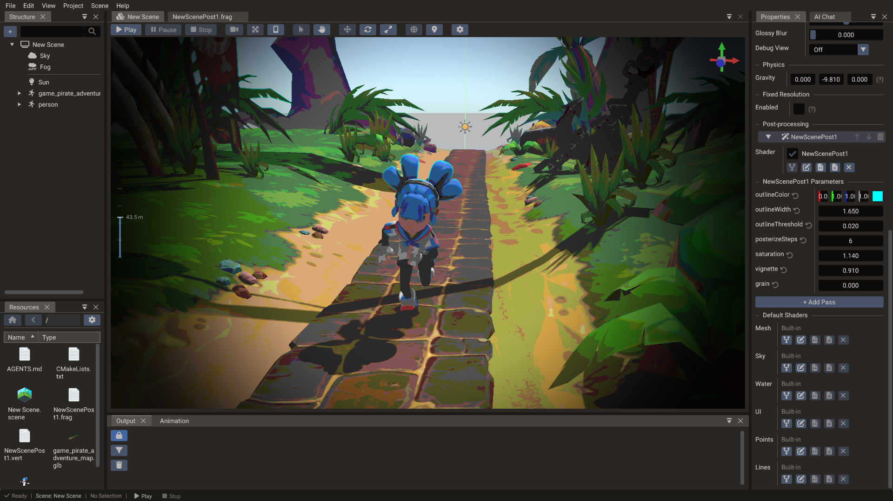
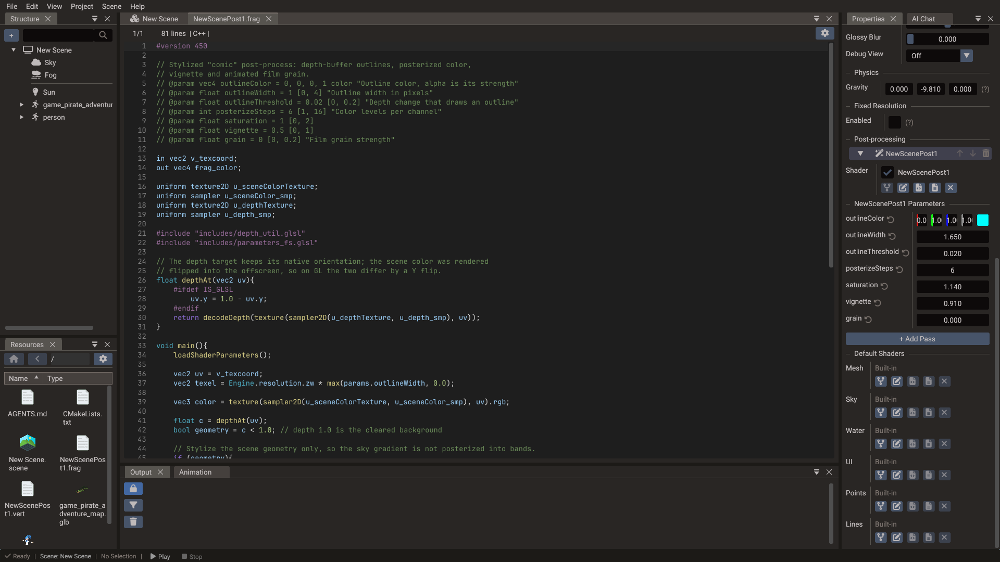

# Custom Shaders

A custom shader is a **shader file** (`.glsl`) or a **shader graph** (`.shader`) of your
project. It does not replace the engine's shaders: it fills hooks they call, to move the
vertices, change the surface, replace the lighting, cut fragments away or recolor what is
drawn. Lighting, shadows, fog, skinning, instancing and every
[shader variant](../manual/shader-variants.md) keep working, and the depth, shadow and
G-buffer passes run the same hooks as the color pass, so shadows, SSAO and reflections
follow what is drawn.

- [Shader Files](../manual/shader-files.md) explains how to write one: the hooks of each
  type, what they read, parameters, textures and varyings.
- [Shader Graphs](shader-graphs.md) explains the node editor that builds one without code.

This page is about giving them to what draws, and about their values.

## The Shader row

Each slot that takes a shader has a **Shader** row in the [Properties](properties.md)
window:

| Draws | Where the row is |
| --- | --- |
| Meshes, models, sprites, tilemaps | In each material, with its maps: every submesh has its own shader. Terrain takes none |
| UI (Image, Text, Polygon and the like), Points, Lines, Sky, Water | In the component |
| A post-process pass | In the pass, see [Post-process passes](#post-process-passes) |
| Everything of a type in a scene | In the scene's [Default Shaders](#scene-default-shaders) |

| Control | Action |
| --- | --- |
| Label | The shader's path, *(built-in)* for one of the engine's, *(scene default)* when the slot inherits the scene's, or **None** |
| **New** | Offers **Shader code** or **Shader graph**, of the slot's type, written under `shaders/` and named after the entity. It is assigned and opened in the [Code Editor](code-editor.md) or the [graph window](shader-graphs.md). Available while the slot is empty |
| **Engine shaders** | For materials: the engine's shader files, the wind, the push, the see-through opening, the height cut and the dissolve, described in [Shader Files](../manual/shader-files.md#the-engines-shader-files) |
| **Pick** | Chooses a `.glsl` or `.shader` of the project |
| **Copy** | Copies the engine shader the slot uses into the project, to change it, and uses the copy |
| **Open** | Opens the file: code in the Code Editor, a graph in the graph window |
| **Remove** | Empties the slot, back to the scene default or the built-in shader |
| Drag and drop | A `.glsl` or `.shader` dropped from the [Resources](resources.md) panel on the row assigns it |

Every change is undoable. The build checks that a file is for the slot's type
(`#pragma shader mesh` for a material), and a file that fails to build leaves the slot
drawing with the built-in shader while the Output window shows the error, with the line,
and for a graph the node. A graph [function](shader-graphs.md#functions) goes in no slot:
other graphs call it.

A mesh's **Vertex Offset** section keeps **Max Offset**, the longest distance its vertex hooks
move a vertex, which culling also widens the bounds by; see
[Vertex offsets](../manual/shader-files.md#vertex-offsets).

!!! note "glTF models"
    A multi-node glTF `Model` renders through its part entities, one Mesh component each.
    Give the shader to the materials of the parts, like color and textures, not to the
    Model root.

## Water shaders

A water's one shader file fills both of its hooks: `getColor` on the surface, and
`getUnderwaterColor` on the fade drawn over the scene while the main camera is below the
surface (with **Underwater** on). Both read the water's parameters by name. The surface
shader can also be a [scene default](#scene-default-shaders).

[Water.getHeight](../reference/classes/water.md#getheight-getnormal), body
[buoyancy](../manual/physics.md#buoyancy) and the sorting of transparent objects around
the water use the engine's waves, which a water shader file does not change.

## Scene default shaders

Each scene can give every component of a type the same shader. Select the scene (no
entity) in the **Structure** panel and open **Default Shaders** at the bottom of its
properties. 3D scenes list Mesh, Sky, Water, UI, Points and Lines; 2D scenes leave out Sky
and Water; UI scenes list only UI. Each row has the controls of the Shader row.

A component draws with:

1. its own shader, set on its material or the component;
2. else the scene default of its type, shown on its row with *(scene default)*;
3. else the engine's built-in shader.

A default's parameters show under its row, and the values set there belong to the scene:
every component that inherits the shader reads them, unless it sets its own. Scripts reach
the defaults through the `Scene` properties `defaultMeshShader`, `defaultUIShader`,
`defaultSkyShader`, `defaultPointsShader`, `defaultLinesShader` and `defaultWaterShader`,
and their values through
[`setDefaultShaderUniform`](../reference/classes/scene.md#setdefaultshaderuniform), which
takes the shader type (`ShaderType.MESH`, `ShaderType.UI` and so on).

## Shader parameters

A shader declares its values with `#pragma` lines, as
[Declaring parameters](../manual/shader-files.md#declaring-parameters) explains, and a
graph with its parameter list. Each becomes a field.

### Editing values

Below a Shader row, the shader's **Parameters** show one field per `#pragma param`, with
its range, color picker and tooltip; a texture parameter shows a texture field, which also
takes a camera's render target. Saving the file updates the fields.

- A material keeps its own values, so two submeshes of a mesh can give one shader
  different values. A UI, Points, Lines, Sky or Water component keeps them on the
  component, and a pass on the pass.
- A field nobody set shows the value inherited from the scene's default shader, else the
  declared default. Editing it gives the slot its own value, and the arrow next to it drops
  it again.
- Renaming or deleting a parameter leaves its old value unused.

The section also lists the scene and view parameters the file reads. The scene's
properties list every scene parameter its shaders declare under **Shader Parameters**,
and a camera's properties its view parameters, both saved with the scene. Every edit is
undoable, and nothing is rebuilt: a value only rewrites a uniform block.

### Setting values from scripts

`Mesh` and everything derived from it (`Shape`, `Model`, `Sprite`, `Tilemap`; `Terrain`
ignores a shader), `Image`, `Text`, `Polygon`, `Points`, `Lines`, `SkyBox` and `Water`
expose:

| Method | Meaning |
| --- | --- |
| `setShader(path)` | Gives the object a shader file or graph; a mesh gives it to every submesh, and `setShader(submesh, path)` to one |
| `getShader()` | The path, empty for the built-in shader |
| `setShaderUniform(name, value)` | Sets a parameter. `value` is a `float`, `Vector2`, `Vector3` or `Vector4`; the components a narrower value leaves out read zero |
| `getShaderUniform(name)` | The object's own value as a `Vector4`, zero when unset |
| `removeShaderUniform(name)` | Drops the value, so the parameter reads the inherited or declared default again |
| `setShaderTexture(name, texture)` | Sets a texture parameter |

A mesh also has `vertexOffsetMax`, and an instanced one `setInstanceCustom(index,
value)`, the [per-instance value](../manual/shader-files.md#per-instance-values). Setting
a value rewrites the uploaded block with no shader reload, so calling it every frame is
fine:

=== "C++"

    ```cpp
    Shape water(&scene);
    water.createPlane(20, 20);
    water.setShader("shaders/wave.glsl");
    water.setShaderUniform("amplitude", 0.3f);
    water.setShaderUniform("tint", Vector4(0.2f, 0.5f, 1.0f, 0.5f));
    ```

=== "Lua"

    ```lua
    function WaveScript:init()
        self.water = Shape(self.scene)
        self.water:createPlane(20, 20)
        self.water:setShader("shaders/wave.glsl")
        self.water:setShaderUniform("amplitude", 0.3)
        RegisterEngineEvent(self, "onUpdate")
    end

    function WaveScript:onUpdate()
        self.water:setShaderUniform("amplitude", 0.3 * self.stormLevel)
    end
    ```

A shader given only at runtime must be in the export, see
[Export and runtime](#export-and-runtime).

## Post-process passes

A scene can run an ordered chain of **fullscreen passes** over its finished image:
sharpen, tint, vignette, color grading and so on. Each pass runs a `postprocess` shader
file or graph, and the chain belongs to the scene, not to an entity.



Select the scene (no entity) in the **Structure** panel and open the **Post-processing**
section of its properties.

| Control | Action |
| --- | --- |
| **Add Pass** | Appends a pass. A new pass starts on the built-in passthrough, which copies the image unchanged |
| Pass header | Names the pass after its shader, followed by its place in the chain when the panel is wide enough. Click it to fold the pass. It is dimmed while the pass is disabled |
| **↑** / **↓** | On the header. Moves the pass in the chain. Passes run top to bottom |
| **🗑** | On the header. Removes the pass. Right-clicking the header offers the same actions |
| Checkbox | Before the shader name in the **Shader** row. Enables or disables the pass without removing it |
| **Shader** row | The controls of any other Shader row |

Every change is undoable, and the chain is saved with the scene. An agent connected
through the [MCP server](mcp-server.md), or the AI Chat, edits the same chain:
`list_post_process_passes` reads it and `set_post_process_pass` adds, removes, moves,
enables or repoints a pass.

The chain runs on the scene's **active camera**, after the opaque, transparent, UI and SSR
passes, and before the fixed-resolution upscale. Secondary cameras (minimaps, mirrors,
portals) do not run it; if the active camera renders to a texture, the chain writes into
that texture. A scene drawn as a layer skips its chain, because a fullscreen pass would
overwrite the scene below it.

A pass reads the previous pass, the scene depth, normals and occlusion through the
functions [Post-process](../manual/shader-files.md#post-process) lists, bound only when it
calls them; while SSR and SSAO are both off, the engine runs a depth prepass for a chain
that reads the depth.

### Pass values

A pass's parameters are fields of the pass, stored by name on it. `Engine.resolution`
holds the size of the pass target and its inverse: use it for anything that depends on
target size, since a texel offset written as a literal breaks the moment the window
resizes. Scripts set them without rebuilding the chain, so it can run every frame:
`scene:setPostProcessUniform(index, name, value)` (index 0 is the top of the list, also from
Lua), `getPostProcessUniform`, `removePostProcessUniform`, `setPostProcessTexture`, and
`setPostProcessPassEnabled(index, enabled)`. The whole chain is `scene.postProcessPasses`,
a list of `PostProcessPass` values with `shader`, `enabled` and `setUniform`/`getUniform`,
for scripts that build it themselves (in Lua a 1-based sequence, so
`scene.postProcessPasses[1]` is pass index 0).

=== "C++"

    ```cpp
    scene.setPostProcessUniform(0, "amount", 0.8f);
    ```

=== "Lua"

    ```lua
    scene:setPostProcessUniform(0, "amount", 0.8)
    ```

Every pass ships its shader, disabled ones included, since the enable flag is a runtime
value. A pass whose shader fails to build falls back to the passthrough, so the scene
keeps rendering; the list marks it **Shader failed to build** and the compiler output goes
to the Output window.

## Editing and live updates

Shader files open in the [Code Editor](code-editor.md) with GLSL highlighting. Saving one
recompiles the shaders that reach it through `#include` and refreshes the view, with no
rebuild or replay. An edit in another editor is picked up when the file reloads. A graph
needs no saving to be seen: the view shows its edits a moment after each one, while it
compiles.



## Shader locations

Shader files and graphs live anywhere in the project. **New** writes them under
`shaders/`, and a file includes others from its own folder, then from the project root,
then from the engine library, so you can move, rename or copy files freely. The engine
never reads the sources at runtime: it loads the compiled shaders an export embeds, or the
`.sdat` files of the project's `shaders` folder in the standalone runtime.

## Export and runtime

Custom shaders go through the export pipeline of the built-in ones (see
[Export Window — Shader compilation](export.md#shader-compilation)). Saving a scene
records the variants its components use, and the export compiles them for the target
backends and embeds them; a graph is compiled first. A shader that a script gives an
object at runtime has no recorded variant, so add it to the export overrides with the
file after `@`, as in `mesh:Uv1,Puc,Nor@shaders/dissolve.glsl`. The
[`shaders` command](command-line.md#shaders-generate-shader-files-standalone) writes
loose `.sdat` or JSON files of any variant.
