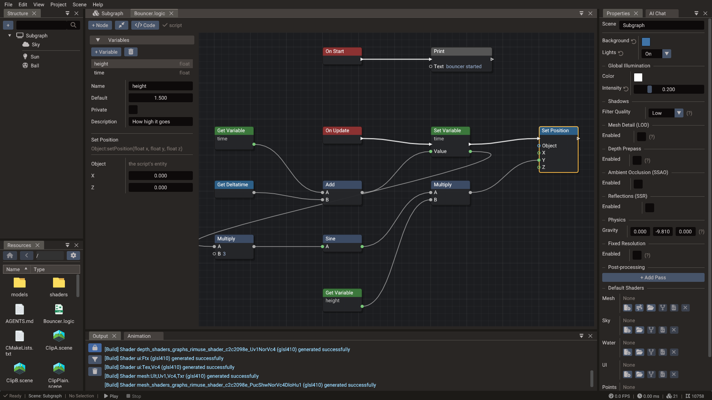

# Logic Graphs

A **logic graph** (`.logic`) builds a [script](../manual/creating-scripts.md) from nodes.
Events start it, white links carry the order things run in, and the other links carry
values. Saving the graph writes a Lua script beside it, `Door.logic` to `Door.lua`, and
that script is what entities run: the engine, Play and an export only ever see the Lua,
exactly as if it had been written by hand.

## Making one

- In [Resources](resources.md), **New** → **Logic Graph** writes one in the current
  folder, which must be inside the project's Lua directory. It starts with **On Start**
  and **On Update**.
- An agent creates one with `edit_graph` and `create`, see [From agents](#from-agents).

The file name is the script's name, so it starts with a letter and has only letters,
digits and `_`. A graph named as an engine class, `Camera.logic`, is fine: its script's
table is then `CameraScript`. Opening a new graph writes its script. Give the script to an entity as
any Lua script: in the **Script** component of [Properties](properties.md), add the
`.lua`. The script's row then has a graph button that opens the graph.

A `.lua` that was not written by a graph is never overwritten: a graph named like a
script that already exists reports it and leaves the file alone.

## How a graph runs

| Kind of node | Pins | What it becomes |
| --- | --- | --- |
| Event | A white arrow out, and the event's values | A method of the script, registered when the script starts. **On Start** is `init` |
| A node that runs | A white arrow in and out | A statement, in the order the arrows are linked |
| A value | Colored circles only | An expression, read where it is used, each time it is used |

- An execution output leads to one node; linking it again moves the link. An execution
  input takes links from any number of outputs; to remove one, click the link and press
  Delete.
- What a node that runs returns is kept for the nodes after it in the same event. A node
  inside a **Branch** side or a loop's body may not have run, so only that side or body
  reads its value, as only a loop's body reads its **Index**. A value node has no memory:
  **Random** linked to two inputs gives two numbers.
- Where two paths lead into the same node, what follows is written once for each path.
  Keep the shared part short, or put it in a **Lua Code** node.
- An event that asks a question, as **Should Collide**, answers yes unless a **Return**
  node gives another **Result**.
- An unlinked **Object** input of an engine class is the script's own entity, so
  **Set Position** alone moves the entity the script is on. Other entities come from an
  **Entity** variable or from the nodes that find them.
- An event's values, as the key of **On Key Down**, are read only by what that event runs.

## Nodes

| Category | Holds |
| --- | --- |
| Events | **On Start**, then every event scripts can register: the engine's frame and application events, input, UI, actions, sound, physics and the platform services |
| Flow | **Branch**, **Sequence**, **For Loop**, **For Each**, **While Loop**, **Do Once**, **Flip Flop**, **Return** |
| Variables | **Get Variable** and **Set Variable** |
| Values | Number, boolean, text, vectors and their parts, a rotation |
| Math, Logic, Text | Arithmetic, which also works on vectors, comparisons, and, or, not, select, join, format |
| Self | The script's entity, its scene, and the entity as an engine class such as `Mesh` |
| Input | **Key**, the keyboard keys by name |
| Utility | **Print**, **Lua Expression**, **Lua Code**, **Call Method** |
| Engine | A category for each class of the [Lua API](../reference/index.md): a node for each method, and a **Get** and a **Set** for each property. Methods that only read, such as **Get World Position** or **Is Key Pressed**, are values; the others run |
| Enums | One node for each enum, with its value as a setting |

Right click the canvas, or press **+ Node**, and type: the search matches every word in
the names, categories and ids, so `object position` finds **Set Position** of `Object`.

**Lua Expression** is a value written in Lua, and **Lua Code** a few lines that run.
Both read their inputs as `a`, `b`, `c` and `d` and the script as `self`, and **Lua Code**
gives its value with `return`. What Lua does not accept is reported on the node.

## Variables

The side panel lists the graph's variables. **+ Variable** adds one of a type: number,
integer, boolean, text, vector, color or entity.

- A variable shows on the script in [Properties](properties.md), where each entity gets
  its own value, as [script properties](../manual/script-properties.md) do.
- **Private** keeps one out of Properties: the script sets it to its default when it
  starts.
- Drag a variable onto the canvas for a **Get Variable**; **Set Variable** is in the node
  search.

## The window

The canvas, undo and the toolbar work as in [Shader Graphs](shader-graphs.md#the-canvas).
**Code** shows the Lua the graph makes, and the status reads **script**, or the number of
errors. Errors are listed in the side panel and outlined on their nodes; while a graph
has errors, saving keeps the script it had.

## From agents

The [MCP server](mcp-server.md) and the AI Chat use the graph tools of shader graphs:

| Tool | Does |
| --- | --- |
| `list_graph_node_types` | With `graph_type` `script`, lists the graph's own nodes and the engine classes; `search` or a class as `category` returns their nodes in full |
| `read_graph` | Reads a `.logic`: variables, nodes, links, whether it compiles and, with `include_code`, the Lua |
| `edit_graph` | Changes it in one step, or creates it with `create`. Nodes added without a position are laid out, one row for each event. The result names the script to attach with `attach_script` |

## Command line

`doriax-editor logic <file.logic> --out <file.lua>` writes a graph's script without the
editor, and `doriax-editor logic-nodes` prints the node types as JSON.
