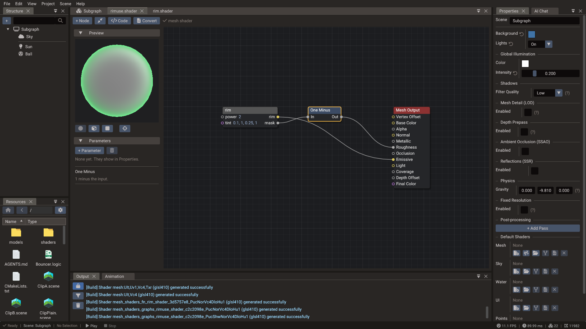
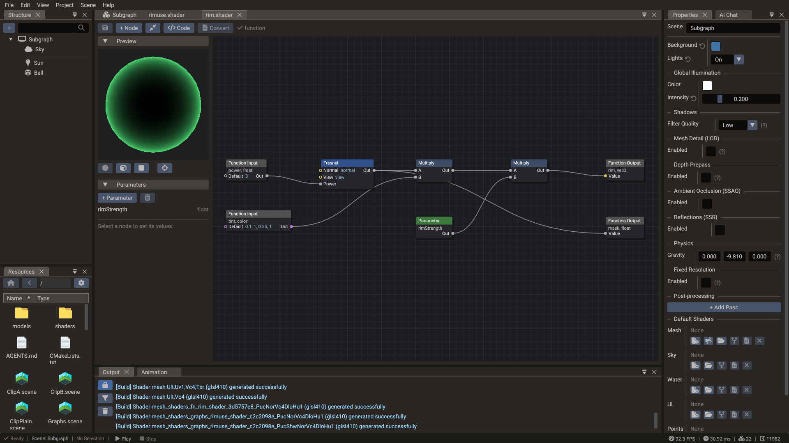

# Shader Graphs

A **shader graph** (`.shader`) builds a [shader file](../manual/shader-files.md) from
nodes. Its output node has one input per thing the shader can change, the base color,
the roughness, the vertex offset, the final color and so on, and whatever feeds an input
becomes the hook that fills it. The editor turns the graph into a shader file when it
builds, so a graph goes in every slot a `.glsl` does and draws exactly as the same code
would. Every node is listed in [Shader Graph Nodes](../reference/shader-nodes.md).

The Mesh Output's **Light** input replaces the engine's shading of each light with what
feeds it, as `getLight` does in a [shader file](../manual/shader-files.md#lighting-and-the-final-color):
the nodes behind it run once per light and read it through the **Light** node, its
direction, color and shadow, and the surface through the **Material** node.



## Making one

- On a **Shader** row in [Properties](properties.md), **New** → **Shader graph** writes a
  graph of the slot's type under `shaders/`, assigns it and opens it.
- In [Resources](resources.md), **New** → **Shader Graph** → a type writes one in the
  current folder; **Function** writes a [function](#functions) instead.
- An agent creates one with `edit_graph` and `create`, see [From agents](#from-agents).

A new graph holds only its output node, and draws as the built-in shader until something
feeds it. Double-click a graph in Resources, or press **Open** on its Shader row, to open
it in a tab next to the scenes and code. Open graphs come back with the project.

## The window

| Part | What it does |
| --- | --- |
| **+ Node** | Opens the node search at the center of the view |
| **Frame** | Fits the graph in the view (F frames the selection) |
| **Code** | Shows the shader file the graph makes, read-only; **Graph** goes back |
| Status | The graph's type, or how many errors it has |
| **Convert** | At the right. After you confirm, writes that code beside the graph as a `.glsl`, gives it to every slot that used the graph, and opens it in the Code Editor. The graph file stays, unused, and undo does not bring it back |
| Side panel | The [preview](#preview), the [parameters](#parameters), the selected node, group or comment, and the errors. Drag its edge to widen it |
| Canvas | The nodes |

Ctrl+S, or **File** → **Save**, writes the file; the tab shows a dot while there are
unsaved edits.

## The canvas

| Action | How |
| --- | --- |
| Pan | Drag with the middle button, or with the right one |
| Zoom | Mouse wheel, around the cursor |
| Select | Click a node; Ctrl or Shift + click adds or removes it; drag on empty space for a box; Ctrl+A for all |
| Move | Drag a node, or a group by its title: a group carries what lies inside it |
| Link | Drag from an output to an input, or the other way. An input takes one link, so a new one replaces the old |
| Unlink | Drag a link off the input it feeds and drop it on empty space, or click the link and press Delete |
| Add a node | Right click, or drop a link on empty space: the search opens, and the new node takes the link on its first pin that fits |
| Reroute | Double-click a link to put a point on it |
| Delete | Delete or Backspace. The output node stays |
| Copy, cut, paste, duplicate | Ctrl+C, Ctrl+X, Ctrl+V at the mouse, Ctrl+D |
| Undo, redo | Ctrl+Z, Ctrl+Y or Ctrl+Shift+Z, or the Edit menu. Each gesture or typed value is one step |

A link joins only types that convert: a number into a number or a vector, a vector into
one of its size or a shorter one (into a single number, split it first), a texture into
its own type, a bool into a bool, and never back into a node that feeds the link. Pins are colored
by type. Positions snap to a grid of 10.

The node search matches names, categories and ids as you type, and Enter takes the first
match. It lists only the nodes the graph's type has (Scene Color only for meshes and
post-process passes, Sky Direction only for the sky), and after a dropped link only those
with a pin that fits. **Group** and **Comment** are in it too; the side panel renames a
group and changes its color, or edits a comment's text.

## Parameters

Parameters are the graph's values for Properties, the `#pragma param` lines of the code.
**+ Parameter** adds one by type: float, vector 2 to 4, color, integer, 2D texture or cube
map, and the trash button removes the selected one with its links. Selecting one in the
list edits its name, default, range, the filter and wrap of a texture, whether scripts set
it (it is then hidden in Properties) and its description.
Nodes refer to a parameter by its id, so renaming one changes nothing else; a name must be
a GLSL name nobody else uses.

Drag a parameter from the list onto the canvas: a value becomes a **Parameter** node and a
texture a **Sample Texture** node set to it. The Texture setting of a sample node, and the
Parameter setting of a Parameter node, list the parameters that fit.

Values are set where the graph is used, as for any shader: in the material's or the
component's [Parameters](custom-shaders.md#editing-values), or with `setShaderUniform`
and `setShaderTexture` from scripts.

## The inspector

Select one node to see its description, its settings (a choice such as a texture's color
space, a parameter, or text such as a Custom Function's code) and the constants of the
inputs nothing feeds. An input that reads a field of the context by default, as UV reads
`uv1`, shows it with **Set** to give it a constant instead; a constant has a reset arrow
back to the default. The output node's inputs that are left alone keep what the material
gives.

## Preview

The scene shows a graph's edits a moment after each one, saved or not, on every object
that uses it, as long as the graph compiles: while it has an error the scene keeps the
last graph that did. Closing the window without saving, or reloading the file, hands the
scene back to the file. Exports always take the saved file.

A mesh graph also draws on a lit sphere, cube or plane at the top of the side panel, with
the defaults of its parameters. The crosshair button next to the shapes draws the selected
node's value instead, its first output as the final color, or as the vertex offset when
nodes that work per vertex feed it; with nothing selected it draws the graph.

## Errors

A node with an error has a red border and says why when the mouse is over it, and the side
panel lists every error: click one to select and frame its node. A Custom Function whose
code fails to compile names its node too, in the Output window as well. Typical errors are
a texture node without a texture, a value of a type the input cannot take, and a node that
reads something the graph's type does not have.

## Functions

A **function** is a `.shader` of type `function`: a part other graphs reuse. It has no
output node of a shader type. Instead:

| Node | What it does |
| --- | --- |
| **Function Input** | A value the function takes, with a name, a type (`float`, `vec2`, `vec3`, `vec4`, `color`, `int` or `bool`) and a **Default** for when the caller passes nothing. Nodes can feed the Default, such as UV |
| **Function Output** | A value it gives back, with a name and a type |



A **Subgraph** node calls a function from any graph, another function included. Its pins
are the function's inputs on the left and its outputs on the right, top to bottom as those
nodes stand in the function, and it takes the function's name as its title. Add one from
the node search and pick the function in the inspector, or drop a function from Resources
on the canvas. Double-click a Subgraph node to open its function.

- A function takes any node: the graph calling it decides where each one runs, so a
  function with Wind Sway feeds the vertex offset of mesh graphs, and one with Sky Direction
  works in sky graphs.
- The function's parameters become parameters of every shader that calls it, by name. Two
  calls share them, and a parameter of the calling graph with the same name and type is the
  same one. A texture the function samples comes in that way.
- The calling graph builds the function's nodes into its own code, as if they stood there,
  so a call costs what the same nodes would.
- Editing a function rebuilds the graphs that call it, in the scene and in their windows,
  saved or not. Exports read the saved files.
- The window of a function previews its first output: on the sphere when its nodes fit a
  mesh, as the vertex offset when nodes that work per vertex feed it. It checks every output.
- An error inside a function shows on the Subgraph node of the calling graph, after the
  function's path. A function that calls itself, directly or through another, is an error.
- Renaming or moving a function in Resources updates the Subgraph nodes that call it.
- A function goes in no Shader slot, and **Convert** is off for it.

## The file

A graph is a short YAML file, sorted the same way every time, with whole-number
positions, so a version control diff shows what changed:

```yaml
version: 1
kind: shader
type: mesh
nextId: 6
parameters:
  - {id: 1, name: tint, type: color, default: [0.2, 0.6, 1, 1], description: Noise tint}
nodes:
  - {id: 2, type: output/mesh, pos: [600, 0], in: {roughness: 0.3}}
  - {id: 3, type: noise/gradient, pos: [0, 0], in: {scale: 8}}
  - {id: 4, type: parameter, pos: [0, 120], parameter: 1}
  - {id: 5, type: math/multiply, pos: [300, 0]}
links:
  - [5.out, 2.baseColor]
  - [3.out, 5.a]
  - [4.rgb, 5.b]
```

A link goes from `node.pin` into `node.pin`; `node.pin.xyz` takes some components of an
output, and `node.xyz` those of a node's first output. Ids are never reused. A function is
`type: function`, and a Subgraph node names it with `file`, as in
`{id: 7, type: utility/subgraph, pos: [0, 0], file: shaders/rim.shader, in: {power: 2}}`. The
code a graph builds is written to `.doriax/generated/shaders/<path>.glsl`, where you can
read it.

## From agents

An agent connected through the [MCP server](mcp-server.md), or the AI Chat, builds graphs
with three tools that answer from the node catalogue:

| Tool | What it does |
| --- | --- |
| `list_graph_node_types` | The nodes a graph type takes, short, or complete for the words or category asked |
| `read_graph` | A graph as JSON, whether it compiles with each error's node, and the code on request |
| `edit_graph` | Operations applied in order as one step, all or nothing: add, remove, move, connect, disconnect, set a setting or a constant, add, change or remove a parameter, add a group or a comment. `create` makes the file |

Within one `edit_graph` call, a node can be named by a `ref` an earlier operation gave
it, and the output node is `output`, so one call can build a whole graph; nodes without a
position are laid out in columns by their distance from the output. `create` with
`graph_type` `function` makes a [function](#functions) holding one Function Output, which
answers to `output`; a Subgraph node takes the function's path through `set` with `file`,
and `read_graph` lists its pins. A graph open in the
editor takes the edit as one step you can undo there, and one with unsaved edits is
refused until you save or close it. Assign the result like any shader file, for example
with `set_component_property` and `submeshes[0].material.shader`.
