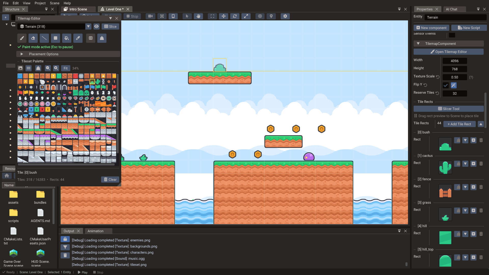
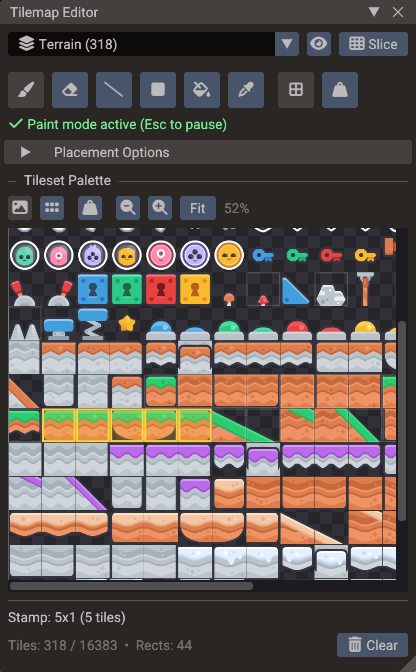

# Tilemap Editor

The **Tilemap Editor** is the window for painting tiles into entities with a **Tilemap**
component. You pick tiles from a palette of the tileset and paint them in the
[Scene View](scene-view.md) with brush, line, rectangle, and fill tools. The tiles come
from the tilemap's rects, which you cut with the [Tileset Slicer](tileset-slicer.md).

## Opening the window

Select the tilemap entity and click **Open Tilemap Editor** at the top of its Tilemap
component in the [Properties](properties.md) window, or choose **View → Tilemap Editor**.
The window follows the selection. When the selection is not a single tilemap, it lists
the scene's tilemaps so you can pick one. Tilemaps can't be edited while a scene is
playing.

## Paint mode

While paint mode is on, clicks in the scene view paint tiles instead of selecting
entities, and the transform gizmo is hidden. Opening the window from the Properties
button, picking a tile in the palette, or choosing a tool turns it on. Click the active
tool again or press **Esc** to pause it and go back to selecting.

The middle mouse button, Alt, Space, and the hand tool still move the view while you
paint. The cell under the cursor previews what will be placed, and it turns red where
nothing can be painted.

## Layers

The bar at the top lists the scene's tilemaps with their tile counts, so you can switch
layers without leaving the window. The eye button hides or shows the current layer, and
**Slice** opens the Tileset Slicer for it.

The selected tile stays selected when you switch to a layer sliced from the same textures
with the same rects. Any other tilemap starts with its first tile.

## Tools

| Tool | Key | Use |
| --- | --- | --- |
| **Brush** | B | Paints the selected tile or stamp along the drag. Shift+click draws a straight line from the last painted cell |
| **Eraser** | E | Removes the tiles along the drag |
| **Line** | L | Drag to lay out a straight line, painted when you release the button |
| **Rectangle Fill** | R | Drag to lay out a filled rectangle, painted when you release the button |
| **Flood Fill** | G | Fills the connected cells that match the clicked one, either the same tile or empty |
| **Eyedropper** | I | Click a placed tile to select it in the palette and go back to the Brush |

In 2D and UI scenes the right mouse button erases with any tool. Ctrl+click picks the tile
under the cursor like the Eyedropper, without changing the tool. Until the tilemap has
rects, only the Eraser and the Eyedropper are available.

Line, Rectangle Fill, and Flood Fill repeat a multi-tile stamp as a pattern. Flood Fill
stops after 4096 cells and stays inside the area the existing tiles cover. On an empty
tilemap it fills from the origin to 15 cells past the clicked one. A rectangle with more
cells than the 16 383 tiles a tilemap can hold turns red and isn't painted.

The grid starts at the tilemap's origin, where the first column line is green and the
first row line is red. Tiles are painted from the origin onward on both axes. The Eraser
also removes tiles that sit before the origin, which you can place from the Properties
window or move there with the gizmo.

## Placement options

| Option | Meaning |
| --- | --- |
| **Cell size** | **Auto** steps the grid by the selected tile's size. Turn it off to set the width and height yourself |
| **Replace tile** | Painting over a tile replaces it. Off stacks the new tile on top |
| **Randomize** | Paints a random pick of the variants in each cell |

With **Auto** on, painted tiles keep their rect's size. Otherwise they take the cell size.

## Palette

The buttons above the palette switch between two views.

**Sheet view** shows the tileset texture with each rect outlined. Click a tile to select
it, or drag a box over several tiles to select them as a stamp, which paints them
together in the same layout. Zoom with the buttons, Ctrl+scroll, or **Fit**.

**Grid view** shows one thumbnail per rect, with a search box that matches names and IDs,
a filter for solid or passable tiles, and buttons for the thumbnail size (Ctrl+scroll
works too).

In both views, Ctrl+click adds a tile to the variants or removes it, and **Randomize**
turns on once there are two. A tilemap with several textures shows a selector above the
palette with the rect count of each texture.

The footer shows the current brush, the number of tiles against the 16 383 a tilemap can
hold, and the number of rects. **Clear** removes every placed tile.

## Collision

The weight button in the toolbar highlights solid tiles in the scene view and the
palette. Turn on the weight button above the palette, **Collision Paint**, to click or
drag across tiles and switch them between solid and passable. In Grid view you can also
right-click a tile to switch it.

This is the rect's **Collision** setting, which the tilemap's collision shape reads. See
[Adding collision](tileset-slicer.md#adding-collision).

## Undo

Every stroke, fill, collision drag, and **Clear** is one undo step. Line and Rectangle
Fill only paint when you release the button, so pressing **Esc** during the drag cancels
them. With no button held, **Esc** pauses paint mode. Pressing the other mouse button
during a stroke ends it there.

On a tilemap that belongs to a [bundle](bundles.md), painted tiles reach the bundle's
other instances.

## Shortcuts

| Shortcut | Action |
| --- | --- |
| **B**, **E**, **L**, **R**, **G**, **I** | Brush, Eraser, Line, Rectangle Fill, Flood Fill, Eyedropper |
| Right mouse button | Erase, in 2D and UI scenes |
| **Shift+click** | Line from the last painted cell, with the Brush |
| **Ctrl+click** in the scene | Pick the tile under the cursor |
| **Ctrl+click** in the palette | Add or remove a variant |
| **Ctrl+scroll** in the palette | Zoom the sheet, or resize the thumbnails |
| **Esc** | Cancel a Line or Rectangle drag, or pause paint mode |

The tool keys work whenever you are not typing in a field. In paint mode, E and R pick
the Eraser and Rectangle Fill instead of the Rotate and Scale gizmos.

## See also

- [Tileset Slicer](tileset-slicer.md)
- [Scene View](scene-view.md#2d-and-tilemap-editing)
- [2D Graphics](../manual/2d-graphics.md#tilemaps)
- [Tilemap](../reference/classes/tilemap.md)
