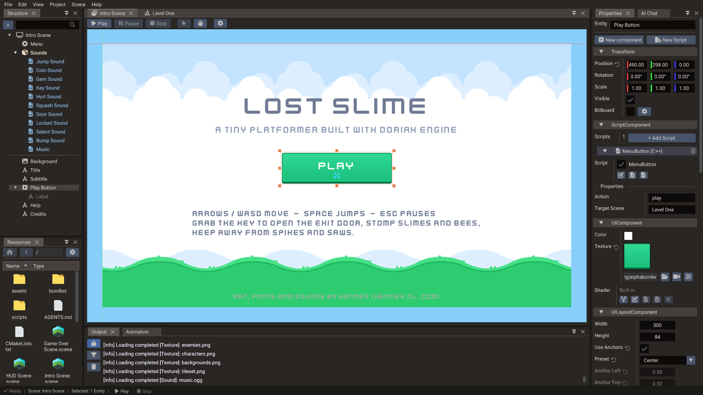

# User Interface

Doriax includes a complete runtime UI system for menus, HUDs, overlays, and in-game
controls. UI entities are regular ECS entities with UI-specific components and layout
state. Because the UI system is built on the same ECS foundation as the rest of the
engine, you can combine UI with 3D, 2D, and scripting seamlessly.



## UI scenes

For anything beyond a single HUD element, put UI into its own **UI scene** and add it
as a scene layer on top of your gameplay scene.

```lua
-- Startup: run gameplay and HUD simultaneously
Engine.setScene(gameplayScene)
Engine.addSceneLayer(hudScene)
```

This approach keeps gameplay entities separate from screen-space widgets, makes it easy
to swap menus without touching gameplay data, and lets you load/unload UI independently
(for example, showing a pause menu without reloading the game level).

UI entities are laid out in their scene's camera space. In a 2D or UI scene that is the
canvas, but in a 3D scene it is the world, so a Text or Image created there is placed among
the models rather than on the screen. A 3D game's HUD therefore goes in a UI scene, even a
single element, added as a layer or as a [child scene](scenes-and-entities.md#child-scenes)
of the level.

Typical UI scene examples:

| UI Scene | Content |
| --- | --- |
| HUD | Health bar, ammo counter, minimap overlay |
| Main menu | Title, Play/Settings/Quit buttons |
| Pause menu | Resume, Options, Quit to menu |
| Settings screen | Sliders, dropdowns, back button |
| Dialog / modal | Confirmation popup, item description panel |
| Loading screen | Progress bar and spinner |

## UI widget classes

| Class | Purpose |
| --- | --- |
| [`UILayout`](../reference/classes/uilayout.md) | Base for all UI elements — anchors, size, and margin |
| [`Image`](../reference/classes/image.md) | Textured or solid-color rectangular region, 9-patch scaling |
| [`Text`](../reference/classes/text.md) | Unicode text with font, size, color, and multiline support; shapes complex scripts and right-to-left |
| [`Button`](../reference/classes/button.md) | Interactive button with normal/over/pressed state textures and label |
| [`Panel`](../reference/classes/panel.md) | Framed or colored container with optional 9-patch background |
| [`TextEdit`](../reference/classes/textedit.md) | Single-line text input with placeholder and password mode |
| [`Scrollbar`](../reference/classes/scrollbar.md) | Horizontal or vertical scroll control with step and onChange callback |
| [`Progressbar`](../reference/classes/progressbar.md) | Horizontal or vertical fill display |
| [`Container`](../reference/classes/container.md) | Automatic layout for vertical, horizontal, or wrapped children |
| [`Polygon`](../reference/classes/polygon.md) | Simple polygon drawing, usable in 2D and UI scenes |

## Text and fonts

Set a font with [`Text.font`](../reference/classes/text.md#font), pointing at a `.ttf`,
`.otf` or `.ttc` file in the project. Leaving it unset uses the fonts built into the
engine: a Roboto subset covering Latin, Cyrillic, Greek and Vietnamese, and an Arabic
subset of Noto Sans Arabic.

Those two always sit at the end of the chain, so a codepoint the chosen font does not
carry is drawn from them. An Arabic-only font still renders Latin digits and labels, and
a Latin-only font still renders Arabic. A codepoint no font covers is drawn as the
missing-glyph box.

For projects needing several custom faces at once, assign up to three additional fonts
to slots `1` through `3`. They are tried in numeric order and empty slots are skipped:

```lua
label.font = "fonts/MyLatin.ttf"
label:setFont(1, "fonts/NotoKufiArabic.ttf")
label:setFont(2, "fonts/NotoSansCJK.ttc")
```

The `font` property is an alias for slot `0`, so replacing it preserves the fallback
chain. C++ has the same `setFont(index, path)` and `getFont(index)` overloads. At direct
component level, `TextComponent::font` is a fixed four-element `FontArray`: the main
font followed by the three fallbacks. See the [`Text.font`](../reference/classes/text.md#font)
reference for all overloads and migration from the former `fontFallbacks` property.

In the editor, set the main face in the Text component's **Font** row. Use the stacked
layers button to open **Additional fonts**, where **Fallback 1–3** can each be browsed,
cleared, or filled by dragging a font from Resources. All slots are saved and exported
as one ordered chain.

### Complex scripts

Strings are shaped before being drawn, so scripts that need contextual glyph forms work
with no extra setup. Arabic letters take their initial, medial, final or isolated shape
from their neighbours, ligatures and kerning are applied, and right-to-left runs are
reordered by the Unicode Bidirectional Algorithm. A label mixing Arabic and Latin lays
each run out in its own direction.

Shaping is per font, so a run only joins within the font that covers it. If Arabic looks
disconnected, the letters are most likely being drawn from a fallback that has no Arabic
shaping rules — set an Arabic font explicitly and the joining returns.

!!! note
    A drawn glyph does not map one to one onto a codepoint. Shaping can merge several
    codepoints into one ligature or expand one into a base plus marks, so
    [`getNumChars`](../reference/classes/text.md#getnumchars) counts codepoints, not
    glyphs.

## Anchors and layout

Every UI element inherits from `UILayout` which exposes an anchor system for
resolution-independent placement. Anchors define how an element is positioned and sized
relative to its parent.

### Anchor presets

Use anchor presets for the most common layouts:

```cpp
Image logo(&scene);
logo.setAnchorPreset(AnchorPreset::CENTER);
logo.setTexture("ui/logo.png");

Image header(&scene);
header.setAnchorPreset(AnchorPreset::TOP_WIDE);  // stretches full width at the top
```

Available presets include `TOP_LEFT`, `CENTER_TOP`, `TOP_RIGHT`, `CENTER_LEFT`,
`CENTER`, `CENTER_RIGHT`, `BOTTOM_LEFT`, `CENTER_BOTTOM`, `BOTTOM_RIGHT`, `LEFT_WIDE`,
`RIGHT_WIDE`, `TOP_WIDE`, `BOTTOM_WIDE`, and `FULL_LAYOUT` (stretch to fill parent).

The layout places an anchored element every frame, so to animate its position use a
[relative track](animation.md#relative-tracks), which moves it by its offset from the
anchors.

### Manual anchors

For precise control, set the four anchor points directly. Anchor point values range from
0 (left/top of parent) to 1 (right/bottom of parent):

```lua
widget.anchorPointLeft   = 0.25
widget.anchorPointRight  = 0.75
widget.anchorPointTop    = 0.0
widget.anchorPointBottom = 0.5
```

## Building UI in code

In Lua, `anchorPreset` and a widget's text/label are **properties**; parenting is done by
calling `addChild` on the parent. Button click handlers live on the `ButtonComponent`
(`onPress` / `onRelease`).

=== "Lua"

    ```lua
    scene = Scene()

    -- Background panel
    panel = Panel(scene)
    panel.anchorPreset = AnchorPreset.CENTER
    panel:setSize(400, 300)
    panel:setTexture("ui/panel_bg.png")

    -- Label
    title = Text(scene)
    panel:addChild(title)
    title.anchorPreset = AnchorPreset.CENTER_TOP
    title.text = "Game Over"
    title.fontSize = 36

    -- Button
    btn = Button(scene)
    panel:addChild(btn)
    btn.anchorPreset = AnchorPreset.CENTER_BOTTOM
    btn.label = "Restart"

    local btnComp = btn:getButtonComponent()
    btnComp.onPress = function()
        SceneManager.loadScene("Game")
    end

    Engine.setScene(scene)
    ```

=== "C++"

    ```cpp
    Scene uiScene;

    Panel panel(&uiScene);
    panel.setAnchorPreset(AnchorPreset::CENTER);
    panel.setSize(400, 300);
    panel.setTexture("ui/panel_bg.png");

    Text title(&uiScene);
    panel.addChild(&title);
    title.setAnchorPreset(AnchorPreset::CENTER_TOP);
    title.setText("Game Over");
    title.setFontSize(36);

    Button btn(&uiScene);
    panel.addChild(&btn);
    btn.setAnchorPreset(AnchorPreset::CENTER_BOTTOM);
    btn.setLabel("Restart");

    btn.getComponent<ButtonComponent>().onPress = []() {
        SceneManager::loadScene("Game");
    };
    ```

## UI events and input

UI widgets receive pointer and touch events automatically. The `Button` fires `onPress`
and `onRelease`; `TextEdit` fires `onChange` when the text changes; `Scrollbar` fires
`onChange` with the new scroll value.

A button shows its state with a texture and a tint colour per state, and it can also grow
when hovered or pressed (`scaleHovered`, `scalePressed`). With a **Transition Time**, the
colour and scale change over that time instead of at once, so menu hover effects need no
script. See [Button transitions](../reference/classes/button.md#transitions).

UI clicks don't also trigger gameplay input (such as shooting when the player taps a UI
button), because `ignoreEventsHandledByUI` is on by default. Turn it off to let the
gameplay handlers see those events too:

=== "Lua"

    ```lua
    Engine.ignoreEventsHandledByUI = false   -- property in Lua
    ```

=== "C++"

    ```cpp
    Engine::setIgnoreEventsHandledByUI(false);
    ```

## Keyboard and gamepad navigation

Menus can work without a mouse once a script focuses one of their buttons, usually when the
menu opens. The focus shows right away:

=== "Lua"

    ```lua
    self.playButton:setFocus()
    ```

=== "C++"

    ```cpp
    playButton->setFocus();
    ```

Until then the arrow keys, Tab, Enter, Space, the d-pad, the left stick, and the gamepad A
button stay with gameplay, so buttons on a HUD don't take them, even after a mouse click.

With a button focused, the arrow keys, the d-pad, and the left stick move the focus to the
nearest visible button in that direction, and Enter, Space, or the gamepad A button presses
it. Tab and Shift+Tab go through the buttons in reading order. Hidden and disabled buttons are
skipped, and so are buttons clipped out of view by a parent image or panel. A held d-pad or
stick repeats after a short delay, like a held key.

A focused button looks hovered, with its hovered colour, texture, and scale, so a menu that
already has a hover effect needs nothing else. Pressing it fires `onPress`, and letting go
fires `onRelease` and the `onClick` of its UIComponent, the same as a mouse click. Moving or
clicking the mouse hides the focus until the next key or gamepad press, which only shows it
again.

While the focused button is hidden, keys and gamepads go back to gameplay, so closing a menu
gives the input back. When the menu shows again, or a menu scene that was removed is added
back, the focus stays hidden until the next key or gamepad press, so a press right after it
opens doesn't click the button left focused last time. Focus a button when the menu opens to
show it right away. If the focused button is disabled or clipped out of view while the menu
stays open, the next press moves the focus to the first button. To let go of the focus, call
`setFocus(NULL_ENTITY)` on the [UISystem](../reference/classes/uisystem.md).

When more than one UI scene is shown, the topmost scene with a focusable button gets the
keys, so a pause menu over the HUD takes them first. Without a focused button there, they go
to gameplay and not to a menu under it. Turn off **Focusable** on a button the focus shouldn't
reach or that shouldn't cover a menu, like a HUD button in the same scene as a menu or in a
scene over it. A TextEdit being typed in keeps the
arrow keys and Enter for its own text, even when another scene has buttons. The keys and buttons that the UI uses don't reach
`onKeyDown`, `onKeyUp`, `onGamepadButtonDown`, and `onGamepadButtonUp` while
`ignoreEventsHandledByUI` is on, and neither does `onGamepadAxisMove` while the left stick
moves the focus. When the stick starts moving the focus, `onGamepadAxisMove` gets it back at
rest, so gameplay doesn't keep the last tilt, and once no menu takes it anymore, gameplay gets
it back as it is. `Input.isKeyPressed` and the other polling functions still see everything.

## 9-patch scaling

`Image` and `Panel` support 9-patch (nine-slice) scaling so borders remain sharp as
the widget resizes. Set the border insets to define the corner and edge regions that
should not be stretched:

```cpp
Image frame(&scene);
frame.setTexture("ui/frame.png");
frame.setPatchMargin(12, 12, 12, 12);  // left, right, top, bottom pixel margins
frame.setSize(300, 200);
```

## Containers

`Container` arranges its children automatically in a vertical stack, horizontal row, or
wrapped grid. This is useful for inventory grids, option lists, and toolbars where the
number of items changes at runtime.

```lua
list = Container(scene)
list.type = ContainerType.VERTICAL   -- type is a property; values: VERTICAL, HORIZONTAL, VERTICAL_WRAP, HORIZONTAL_WRAP

for i = 1, 5 do
    local item = Button(scene)
    list:addChild(item)
    item.label = "Item " .. i
end
```

## Canvas size and scaling

The UI canvas size defines the logical coordinate space. Set a fixed canvas size that
matches your design resolution and choose a scaling mode:

| Scaling mode | Behavior |
| --- | --- |
| `FITWIDTH` | Scale to fit the horizontal axis; may letterbox vertically |
| `FITHEIGHT` | Scale to fit the vertical axis; may letterbox horizontally |
| `LETTERBOX` | Fit inside the screen maintaining aspect ratio |
| `CROP` | Fill the screen, cropping edges |
| `STRETCH` | Stretch to fill (may distort) |
| `NATIVE` | Use actual screen pixel resolution |

Canvas size and scaling are configured on the global `Engine`, not on the scene:

=== "Lua"

    ```lua
    Engine.setCanvasSize(1920, 1080)
    Engine.scalingMode = Scaling.LETTERBOX   -- scalingMode is a property in Lua
    ```

=== "C++"

    ```cpp
    Engine::setCanvasSize(1920, 1080);
    Engine::setScalingMode(Scaling::LETTERBOX);
    ```

See [Multiple Resolutions](multiple-resolutions.md) for the full scaling guide,
including how to keep the UI crisp over a scene that uses a fixed render resolution.

## Practical guidance

- Design against a fixed canvas size (e.g. 1920×1080 or 1280×720) for predictable
  layouts across screen sizes.
- Use anchor presets wherever possible; reserve manual anchor values for non-standard
  layouts.
- Separate HUD, pause menu, and modal dialogs into different root containers or
  separate UI scenes.
- Keep UI textures and fonts organized in a dedicated asset folder.
- Use `Container` for lists and grids so the layout adjusts automatically when items
  are added or removed.
- Test UI scaling on the target aspect ratios early in development.
