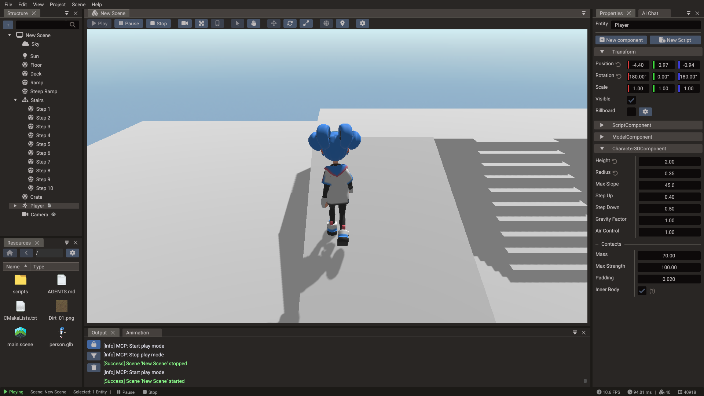
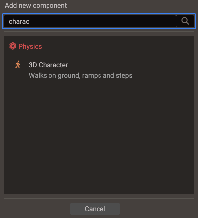
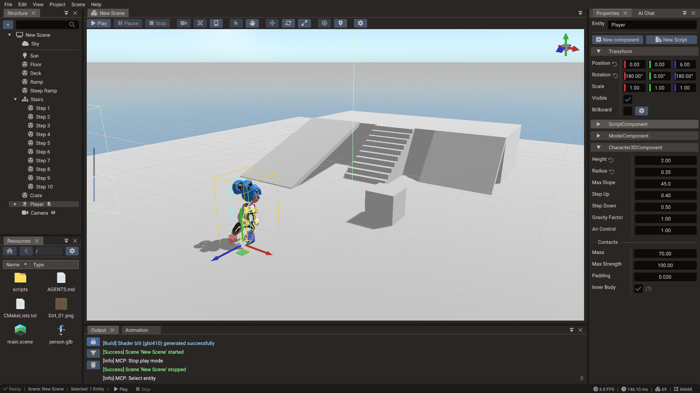

# 3D Character

This tutorial walks a character over a small level with the **3D Character** component. The
character climbs stairs, walks up a ramp, slides off a ramp that is too steep, pushes a crate
and jumps, and its script picks the idle, walk and jump animations from what it stands on.



## What you will build

By the end of this tutorial you will have:

- A level with a ramp, a steep ramp, a flight of stairs and a crate
- A character with a 3D Character component
- A Lua script for walking, jumping, animations and a camera that follows

It assumes you have done [First 3D Scene](first-3d-scene.md).

## 1. Create the project

1. Choose **File → New Project**, then **File → Save All**. Name the scene `main` and save
   the project in an empty directory.
2. Copy a rigged glTF character with idle, walk and jump clips into the project. This
   tutorial uses `person.glb` from the
   [Character Control example](https://github.com/doriaxengine/charactercontrol), whose clips
   are `Idle_Loop`, `Walk_Loop` and `Jump_Start`. For another model, use its own clip names in
   the script below.

## 2. Build the level

Each piece is a box: **+ → Create entity → Basic shape → Box**, then set its Transform. To
make it solid, click **New component → 3D Physics Body**, choose **Box** in the shape list
and click **Add Shape**. The shape is sized by the entity's scale, so it already fits the box,
and the body stays **Static**.

| Name | Position | Rotation | Scale |
| --- | --- | --- | --- |
| Floor | `0, -0.5, 0` | `0, 0, 0` | `30, 1, 30` |
| Deck | `0, 1, -6` | `0, 0, 0` | `10, 2, 4` |
| Ramp | `-3.5, 0.95, -1.25` | `20, 0, 0` | `3, 0.2, 5.85` |
| Steep Ramp | `3.5, 0.95, -3.16` | `50, 0, 0` | `3, 0.2, 2.61` |

The deck is 2 m high. The ramp climbs it at 20 degrees and the steep ramp at 50.

For the stairs, create a **Stairs** object (**+ → Create entity → Object**) and ten box steps
inside it, each 0.2 m higher than the last. Make the first one, give it its body, then
duplicate it (**Ctrl+D**) and change its Y position, Z position and Y scale:

| Step | Position | Scale |
| --- | --- | --- |
| 1 | `0, 0.1, -1.15` | `2, 0.2, 0.3` |
| 2 | `0, 0.2, -1.45` | `2, 0.4, 0.3` |
| 3 | `0, 0.3, -1.75` | `2, 0.6, 0.3` |
| ... | ... | ... |
| 10 | `0, 1.0, -3.85` | `2, 2.0, 0.3` |

Step *k* is at `0, 0.1·k, -0.85 - 0.3·k` with a scale of `2, 0.2·k, 0.3`.

Last, a **Crate** box at `2.5, 0.5, 2`. Give it a body as well, set **Body Type** to
**Dynamic** and its shape's **Density** to `30`, so it weighs 30 kg.

## 3. Add the character

1. Drag `person.glb` from the Resources Browser into the scene view. Name the new Model
   entity `Player`, put it at `0, 0, 6` and set its rotation to `0, 180, 0` so it faces the
   level. Its origin is at its feet.
2. With `Player` selected, click **New component** and choose **3D Character**.

    

3. Set **Height** to `2` and **Radius** to `0.35`, so the capsule drawn in the scene view
   wraps the model. The capsule stands on the entity origin; the amber ring inside it is the
   **Step Up** height.



The defaults already suit this level:

- **Step Up** `0.4` is higher than a stair step (`0.2`), so the character climbs the stairs, but
  lower than the deck, so it cannot step onto it.
- **Max Slope** `45` lets it walk up the 20 degree ramp but not the 50 degree one.
- **Step Down** `0.5` keeps it on the stairs going down instead of falling a little at each
  step.

The character needs no 3D Physics Body: the component moves it and finds the ground itself.

## 4. Add a camera

Choose **+ → Create entity → Camera**. The first camera becomes the scene's main camera; the
script places it behind the player, so its position does not matter.

## 5. Write the script

1. Select `Player`, click **New Script**, choose **Lua Script** and name it `Player`.
2. Open it and replace its contents with:

    ```lua
    local Player = {
        properties = {
            { name = "speed", displayName = "Speed", type = "float", default = 4.0 },
            { name = "jumpSpeed", displayName = "Jump Speed", type = "float", default = 5.0 },
            { name = "camera", displayName = "Camera", type = "Camera" }
        }
    }

    function Player:init()
        RegisterEngineEvent(self, "onUpdate")

        self.object = Object(self.scene, self.entity)
        self.character = Character3D(self.scene, self.entity)
        self.model = Model(self.scene, self.entity)
        self.model:findAnimation("Idle_Loop").loop = true
        self.model:findAnimation("Walk_Loop").loop = true
        self.clip = ""
    end

    function Player:onUpdate()
        local direction = Vector3(0, 0, 0)
        if Input.isKeyPressed(Input.KEY_W) then direction.z = direction.z - 1 end
        if Input.isKeyPressed(Input.KEY_S) then direction.z = direction.z + 1 end
        if Input.isKeyPressed(Input.KEY_A) then direction.x = direction.x - 1 end
        if Input.isKeyPressed(Input.KEY_D) then direction.x = direction.x + 1 end

        local moving = direction:length() > 0
        if moving then
            direction:normalize()
            -- the model looks along +Z
            self.object.rotation = Quaternion(0, math.deg(math.atan(direction.x, direction.z)), 0)
        end

        -- walks along the ground; steps, ramps and gravity are the component's job
        self.character.moveVelocity = direction * self.speed

        if self.character:isOnGround() and Input.isKeyPressed(Input.KEY_SPACE) then
            self.character:jump(self.jumpSpeed)
        end

        local clip = "Idle_Loop"
        if not self.character:isSupported() then
            clip = "Jump_Start"
        elseif moving then
            clip = "Walk_Loop"
        end
        if clip ~= self.clip then
            self.model:playAnimation(clip, 0.15)
            self.clip = clip
        end

        -- the transform is drawn smoothly between physics steps, so the camera follows it
        if self.camera then
            local position = self.object:getWorldPosition()
            self.camera.position = position + Vector3(0, 3.5, 6)
            self.camera.target = position + Vector3(0, 1.2, 0)
        end
    end

    return Player
    ```

3. Save it (**Ctrl+S**), then drag `Camera` from the Structure panel onto the script's
   **Camera** field.

The script never moves the character itself. It sets `moveVelocity`, the velocity the
character walks with along the ground, and keeps it until it changes, so stopping is setting
it to zero. Each fixed step the component adds gravity, slides along walls, climbs steps,
follows ramps and pushes what it walks into. The script only turns the model, since the
component writes the position and leaves the rotation alone.

The ground checks drive the rest:

- `isOnGround()` is true on ground the character can walk on, so it can only jump from there.
- `isSupported()` is also true on a slope too steep to walk. Using it for the jump clip keeps
  the character from playing it while it slides down the steep ramp.

## 6. Play

Press **Play**, click the scene view, and walk with **W A S D**, jumping with **Space**:

- Walk up the stairs, across the deck and down the ramp.
- Walk off the deck onto the steep ramp: the character slides down it, and walking back into
  it does not climb it.
- Walk into the crate to push it. A heavier crate, or a lower **Max Strength** on the
  character, and it stays put.
- Jump on the deck. A jump speed of `5` is about 1.2 m high.

Then stop and try the component values:

| Change | What happens |
| --- | --- |
| **Step Up** `0` | The stairs block the character; it needs the ramp |
| **Max Slope** `55` | The steep ramp becomes walkable |
| **Step Down** `0` | Walking down the stairs, it leaves the ground at every step and the jump clip flickers |
| **Air Control** `0` | A jump keeps the direction it started with |

Press **Stop** when done.

## 7. Next steps

- Crouch with `setShape`, which refuses to stand up under a low ceiling — see
  [Character3D](../reference/classes/character3d.md#setshape).
- Animate a kinematic box as a moving platform: the character rides it — see
  [Moving a body](../manual/physics.md#moving-a-body).
- Add a sensor body as a checkpoint; its `onContactAdded3D` receives the character — see
  [3D sensors](../manual/physics.md#3d-sensors).
- Read [Physics — 3D characters](../manual/physics.md#3d-characters) and
  [Animation](../manual/animation.md) for more.
